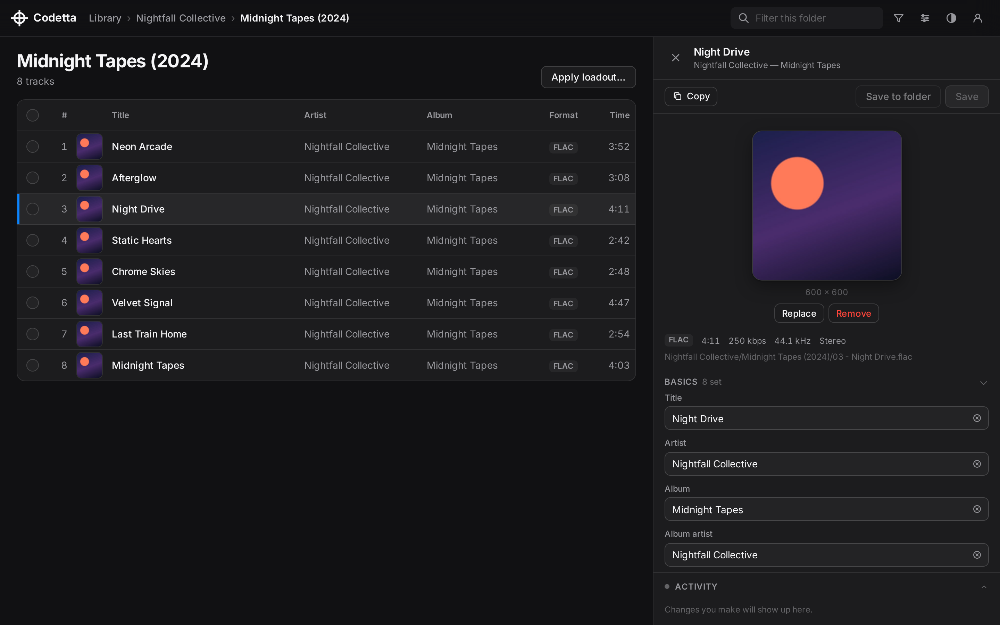
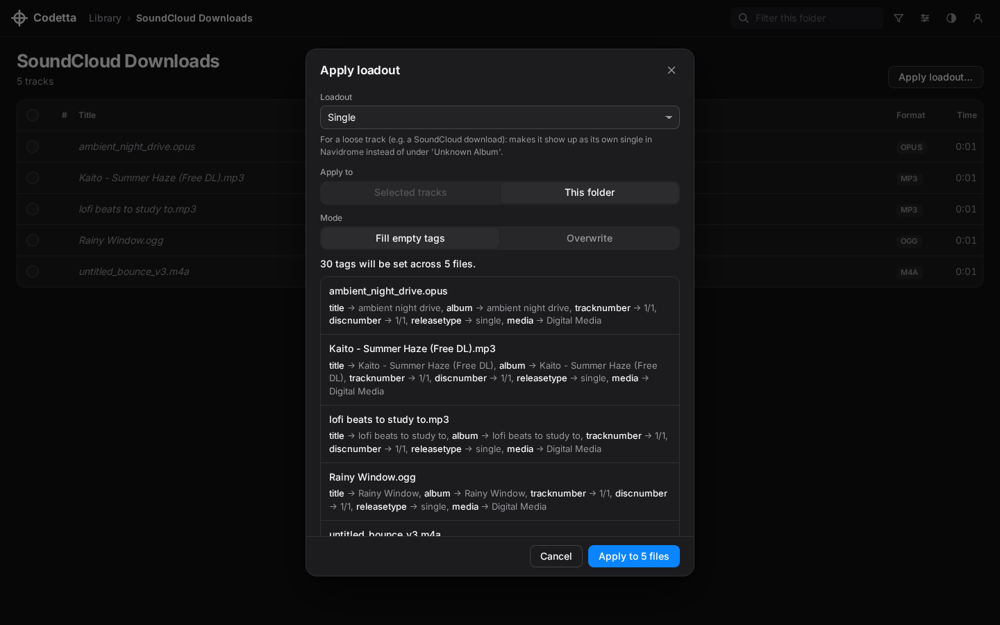

<p align="center">
  
</p>

<h1 align="center">Codetta</h1>

<p align="center">
  A clean, self-hosted metadata editor for your music library.<br>
  Fix tags on FLAC, MP3, M4A, OGG and Opus files from any browser, including your phone.
</p>

<p align="center">
  
</p>

---

## Why Codetta?

If you run your own music server, you know the drill: a SoundCloud download
with no tags, an album where one track says "OCTOBER EP" and the other says
"OCTOBER EP - 1PSYCH3", a folder of loose files that shows up in Navidrome as
*Unknown Album*. Fixing that usually means a desktop tagger and a trip to the
computer that has your library on it.

Codetta runs next to your music on your server. Open it on your laptop or your
phone, pick a track or a whole album, fix what's wrong, and save. Your files
are updated in place, safely, and your streaming apps pick up the changes on
their next scan.

It's built with [Navidrome](https://www.navidrome.org/) and other
OpenSubsonic servers in mind: Codetta writes the tags those apps actually show
(credits, mood, label, release type, multiple artists), in the same places
[MusicBrainz Picard](https://picard.musicbrainz.org/) does.

## Features

- **Edit one track or a whole album.** Select several tracks and change only
  the fields you need. Fields that differ between tracks show as
  *Multiple values* and are left alone unless you change them.
- **Save to folder.** Changed a genre on one track? Apply just that change to
  every track in the album.
- **Smart suggestions.** Album-level fields suggest values that other tracks
  in the same folder already use, and Track suggests the file's position
  (`2/6`). One tap fills the field; nothing saves until you say so.
- **Copy & paste tags** between tracks and folders.
- **Album art.** See every track's cover at a glance, and add, replace or
  remove covers for one track, a selection or the whole album in one save,
  straight from your phone's photo library if you like.
- **Tag Loadouts.** Saved sets of tags with placeholders such as
  `{filename_title}`, `{folder}` and `{track}/{tracktotal}` that turn loose
  downloads into properly tagged singles or albums. You always see a preview
  before anything is written.
- **Filter a folder by tag**, e.g. *Label: Independent*.
- **Activity log with undo.** Every change is recorded with its old and new
  values. Changed your mind? Undo it straight from the log, even for a whole
  album, and redo if you change it back. Files you edited again since are
  left alone.
- **Sign-in** with a hashed password, 30-day sessions and lockout after
  repeated wrong guesses.
- **Any language, any script.** Japanese, Hindi, Korean, Thai, Arabic,
  Tagalog, accented names and emoji are all saved exactly as typed. Search
  ignores accents ("beyonce" finds "Beyoncé"), right-to-left names display
  correctly, and names like "Tyler, The Creator" are never flagged.
- **Light and dark themes** that follow your device, smooth animations,
  and a layout made for phones. Works offline: fonts are bundled.

<p align="center">
  
  &nbsp;
  
</p>

<p align="center">
  
</p>

## How Codetta keeps your files safe

Your music library matters, so Codetta is careful with it:

- **Changes never touch the original until they're verified.** Codetta writes
  each change to a temporary copy, reads it back to check that every tag
  saved correctly, and only then swaps it in, in a single atomic step. If
  anything goes wrong (a full disk, a crash, a power cut), the original file
  is left exactly as it was.
- **Nothing else changes.** Tags you didn't edit, embedded album art, file
  permissions and ownership are preserved. Symlinks are followed, not
  replaced, and hard-linked copies (for example, a torrent that's still
  seeding) keep their original bytes.
- **Codetta only writes when you ask it to.** Browsing never modifies a file.
  Saving, *Save to folder*, applying a loadout and changing album art are the
  only actions that write, and the bulk ones ask you to confirm first.
- **It's tested.** Around 400 automated tests cover every format, including
  corrupt, truncated and mislabelled files, unicode, read-only folders and
  interrupted writes.

That said, it's still your library: **keep a backup**, as you would with any
tool that edits files.

## Installing with Docker

You'll need a server with [Docker](https://docs.docker.com/engine/install/)
and Docker Compose, and your music in a folder on that server.

### 1. Back up your library

If you don't already have a backup of your music folder, make one now. Codetta
is careful, but a backup protects you from the one thing no software can:
editing the wrong album.

### 2. Find the user that owns your music

Codetta runs as a normal user (never root), so the files it edits keep their
owner and your other apps can still read them. On the server, run:

```sh
ls -ln /path/to/your/music | head -3   # the 3rd and 4th columns are the user and group IDs
```

On most single-user servers this is `1000` and `1000`.

### 3. Get Codetta

```sh
git clone https://github.com/gavndev/codetta.git
cd codetta
```

### 4. Point it at your music

Create a file called `docker-compose.override.yml` next to
`docker-compose.yml`, with your own path and IDs:

```yaml
services:
  codetta:
    environment:
      PUID: "1000"   # from step 2
      PGID: "1000"
    volumes:
      - /path/to/your/music:/music
```

Keeping your settings in this separate file means updating Codetta later never
overwrites them.

### 5. Start it

```sh
docker compose up -d
```

Docker builds the image the first time, which takes a minute or two.

### 6. Create your account straight away

Open `http://<your-server>:8111`. The first visit shows **Welcome to Codetta**,
where you choose a username and a password (at least 8 characters).

Do this as soon as Codetta is running: until an account exists, anyone who can
reach the page could create one.

### 7. Try it on one album first

Pick an album you know well, make a small change, and check it in your music
player after its next library scan. Once you're happy, it's ready for the
rest of your library.

## Updating

Your version number is shown on the sign-in screen and in the account menu
(the person icon). When a new release is out, a dot appears on that icon and
the account menu shows what's new and the commands to run. Codetta never
updates itself: that would require giving it control over Docker, and with
it, the rest of your server.

```sh
cd codetta
git pull
docker compose up -d --build
```

Your account, loadouts and activity log live in `./codetta-config` and are kept
across updates.

## Settings

All optional. Set them under `environment:` in your
`docker-compose.override.yml`.

| Variable | Default | What it does |
|---|---|---|
| `PUID` / `PGID` | `1000` | The user and group Codetta runs as. Match your music files' owner. |
| `CODETTA_PORT` | `8111` | The port inside the container. To use a different port on your server, change the `ports:` mapping instead. |
| `CODETTA_USERNAME` + `CODETTA_PASSWORD` | – | Create the account from here instead of the setup screen. The password can then only be changed here. |
| `CODETTA_AUTH` | `on` | Set to `off` to disable sign-in. **Only** do this if a reverse proxy in front of Codetta already requires a login. |
| `CODETTA_UPDATE_CHECK` | `on` | Twice a day, Codetta asks GitHub whether a newer release exists, and shows a dot on the account icon if so. Only the request itself is sent (no information about you or your library). Set to `off` to disable. |
| `CODETTA_ALLOWED_HOSTS` | – | Optional comma-separated host names Codetta answers to (e.g. `music-server,192.168.1.50`). Requests for any other name are refused, which blocks DNS-rebinding attacks. Recommended if Codetta is reachable from more than your own devices. |
| `FORWARDED_ALLOW_IPS` | `127.0.0.1` | If you use a reverse proxy, set this to its IP so login lockouts see each visitor's real address. |

| Folder in the container | What's in it |
|---|---|
| `/music` | Your library. Codetta needs read-write access to edit it. |
| `/config` | Your account, sign-in sessions, profile picture (`avatars/`), loadouts, the activity log (`activity.jsonl`) and previous album art kept for undo (`undo-art/`). Include it in your backups. |

The provided compose file also runs the container with a read-only system
filesystem and without the ability to gain extra privileges.

## Signing in

- Each browser stays signed in for 30 days.
- The person icon in the top bar lets you change your password or sign out.
  Changing the password signs out your other devices.
- After 5 wrong passwords, that device has to wait before trying again
  (30 seconds, doubling each time, up to 15 minutes).

### Resetting your password

From the server:

```sh
docker exec -it codetta codetta-admin set-password
```

You'll be asked for a new password, and every device is signed out. To sign
out every device without changing the password:

```sh
docker exec -it codetta codetta-admin sign-out-all
```

## Remote access and HTTPS

Codetta serves plain HTTP on port 8111. On your home network, or over
[Tailscale](https://tailscale.com/) (which already encrypts traffic between
your devices), that's fine.

**Don't expose Codetta directly to the internet.** If you want an `https://`
address:

- **Tailscale:** run `tailscale serve --bg 8111` on the server to get
  `https://<server>.<tailnet>.ts.net`, reachable only by your devices.
- **A reverse proxy** (Caddy, Traefik, nginx…): point it at port 8111. Codetta
  marks its session cookie `Secure` when the proxy sends
  `X-Forwarded-Proto: https`. A minimal Caddy example:

  ```
  codetta.example.com {
      reverse_proxy localhost:8111
  }
  ```

## Security

- Every page and API call requires signing in, except the sign-in screen itself and a health check.
- Passwords are hashed with scrypt; sessions are random tokens stored only as hashes; repeated wrong passwords are locked out.
- Changes must come from Codetta's own page (cross-site requests are refused), request sizes are capped, and every response carries a strict Content Security Policy.
- Album art from your files is only ever shown as an image, so a malicious file can't run code in your browser.
- The container runs as your user, with a read-only system filesystem and no extra privileges.

Found a security problem? Please report it privately rather than in a public issue.

## Supported formats

| Format | Extensions | Notes |
|---|---|---|
| FLAC | `.flac` | Any tag name is allowed. |
| MP3 | `.mp3` | Saved as ID3v2.4, which Navidrome and modern players read. Some older software prefers ID3v2.3. |
| AAC / ALAC | `.m4a` | |
| Ogg Vorbis | `.ogg` | Any tag name is allowed. |
| Opus | `.opus` | Any tag name is allowed. |

Codetta detects the real format from each file's contents, so a mislabelled
file still opens correctly.

## Known limitations

- One account per Codetta instance (no separate users yet).
- WAV, AIFF, WMA and raw `.aac` files aren't supported.
- Filtering by tag works within a folder, not across the whole library.

## Roadmap

- **MusicBrainz:** match a track or folder to a MusicBrainz release and
  apply its official metadata, with a preview first.
- Library-wide tag search.

## Removing Codetta

```sh
cd codetta
docker compose down
docker image rm codetta:local
```

Your music is never deleted. Remove the `codetta-config` folder too if you
don't want to keep your account, loadouts and activity log.

## Development

Codetta is a [FastAPI](https://fastapi.tiangolo.com/) app using
[mutagen](https://mutagen.readthedocs.io/) for tags, with a plain
HTML/CSS/JavaScript front end (no build step).

```sh
python3 -m venv .venv && source .venv/bin/activate
pip install -e ".[dev]"
pytest
CODETTA_MUSIC_DIR=~/some-test-music uvicorn codetta.web.app:app --reload --port 8111
```

Use a **copy** of some music while developing. Contributor notes are in
[`CLAUDE.md`](CLAUDE.md) and the roadmap in [`PLAN.md`](PLAN.md).

## License

To be decided before the first public release.

## Credits

- [mutagen](https://github.com/quodlibet/mutagen) for reading and writing tags.
- [FastAPI](https://fastapi.tiangolo.com/) and [Uvicorn](https://www.uvicorn.org/).
- [Inter](https://rsms.me/inter/) by Rasmus Andersson, under the SIL Open Font License.
- Tag mappings follow [MusicBrainz Picard](https://picard.musicbrainz.org/docs/mappings/)'s conventions.
