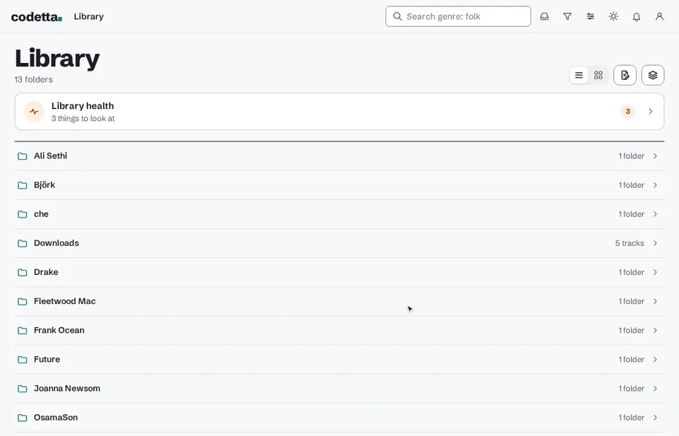
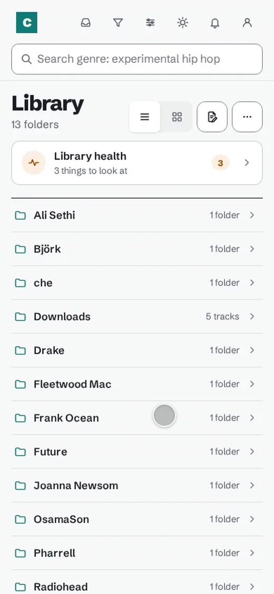

<p align="center">
  <picture>
    <source media="(prefers-color-scheme: dark)" srcset="docs/brand/logo-dark.svg">
    
  </picture>
</p>

<p align="center">
  <strong>Your music library, looked after. On your own server.</strong><br>
  Fix tags, match albums on MusicBrainz, organize your files and bring in new music,<br>
  from any browser, including your phone. FLAC, MP3, M4A, OGG, WAV, AIFF, WMA and more.
</p>

<p align="center">
  
  
  <a href="LICENSE"></a>
  
  <a href="https://github.com/gavndev/codetta/actions/workflows/ci.yml"></a>
  <a href="https://github.com/gavndev/codetta/pkgs/container/codetta"></a>
  
</p>

<p align="center">
  <picture>
    <source media="(prefers-color-scheme: dark)" srcset="docs/media/hero-dark.gif">
    
  </picture>
</p>

<p align="center">
  <a href="https://alternativeto.net/software/codetta/about/?utm_source=badge&utm_medium=referral"></a>
</p>

<p align="center">
  <a href="#quick-start">Quick start</a> ·
  <a href="#what-codetta-does">Features</a> ·
  <a href="#how-codetta-compares">Compare</a> ·
  <a href="#documentation">Docs</a> ·
  <a href="#roadmap">Roadmap</a>
</p>

---

If you run your own music server, you know the drill: a SoundCloud download
with no tags, an album where every track spells the artist differently, a
folder of loose files that shows up as *Unknown Album*. I made Codetta for home server users like me who want finer control over their
library. It's my hobby project, and I thought it could be useful to others too.

Codetta lives on your server, next to your music. **Open it on your laptop or
your phone, pick a track or a whole album, fix what's wrong and hit Save.**
Match albums on MusicBrainz for official tags and cover art, rename and
organize files into tidy folders, and let new music from your downloads folder
be matched and filed for you. Your files are updated **safely**, anything
Codetta does can be **undone**, and [Navidrome](https://www.navidrome.org/)
and other music apps pick up the changes on their next scan.

> [!NOTE]
> **Codetta is in beta.** The latest, 0.9.2, adds Dismiss and Ignore all, New folder and better covers (see the [changelog](CHANGELOG.md)). 0.9.0 was the biggest release yet:
> - **Tidy up** looks after the music you already have, album by album in the background, with a preview first.
> - **Album editions:** pick the original year, format and country you prefer, and switch editions in one tap.
> - **Loose songs** (a single download, a YouTube rip) are matched to the album they came from.
> - **Import** music from your computer or phone, and **Recently deleted** keeps anything you remove for 30 days.
> - A search bar with ideas from your own library, Deezer and iTunes as backup album sources, and a calmer Soulseek.
>
> Everything is in the [changelog](CHANGELOG.md). Codetta is careful with your files and used daily on real
> libraries, but keep a backup of your music, as you would with any tool that edits files.

> **Codetta is AI-Assisted.** I understand the controversy surrounding AI usage in software. I prioritize transparency, hence the disclaimer for those who do not favor AI. This project is assisted by Claude Opus 5.5.

## Quick start

On a server with [Docker](https://docs.docker.com/engine/install/):

```sh
mkdir codetta && cd codetta
curl -fsSLO https://raw.githubusercontent.com/gavndev/codetta/main/docker-compose.yml
cat > docker-compose.override.yml <<'EOF'
services:
  codetta:
    environment:
      PUID: "1000"   # the user that owns your music (ls -ln /path/to/music)
      PGID: "1000"
    volumes:
      - /path/to/your/music:/music
      # Optional: where new music lands (downloads, rips), for the inbox
      # - /path/to/downloads:/inbox
EOF
docker compose up -d
```

Open `http://<your-server>:8111` and create your account. A few short setup
steps follow (online features, folder naming, Tidy up, the inbox, optional
integrations). Each can be skipped and changed later.

Runs on Intel/AMD and ARM, from a Raspberry Pi 4 up: about a 100 MB download
and 70 MB of memory (about 130 MB at 100,000 tracks), and no disk activity when idle. The
[install guide](docs/install.md) walks through every step, including updates.

No server? Run it on your own computer instead: `pipx install codetta`
(or `sudo snap install codetta` on Ubuntu), then `codetta`
([details](docs/install.md#on-your-own-computer)).

## What Codetta does

### Fix a whole album in one go

Select tracks and change only what you need, or fill in one track and
**Save to folder** to apply exactly those changes to the whole album, cover
art included. You see every change before anything is written.

<p align="center">
  
</p>

### Search your entire library by tag

Type in the search box and press <kbd>Enter</kbd>. Results work like a folder,
so you can edit them all at once. Tap the search box for shortcuts (artist,
album, tag) with examples from your own music.

| Type | Finds |
|---|---|
| `genre: rap, hip-hop` | Rap **or** Hip-Hop (but not "Trap") |
| `artist: drake year: 2024` | both at once |
| `night drive` | words in the title, artist, album or file name |

<p align="center">
  
</p>

### Match on MusicBrainz

Official titles, credits, dates, labels, catalog numbers, MusicBrainz IDs and
cover art for any album folder. Switch between every edition of an album, and
choose which edition Codetta prefers (original year, format, country), then
review every change per file before anything is written. Loose songs (a single
download, a YouTube rip) are matched to the album they came from. Untagged files are recognised by sound. When
MusicBrainz is down or doesn't know an album yet, Deezer and iTunes (optional,
no account needed) step in with details and big covers.

<p align="center">
  
</p>

### Organize your library

**Organize** renames and moves files from their tags with a pattern like
`{albumartist}/{album} ({year})/{disctrack} {title}`. You see every move
first, nothing is ever overwritten, and the whole thing can be undone.

### Tidy up your library

Choose once how Codetta should treat the music you already have: leave it as
it is, fix tags only, or tags plus file names and folders (with a preview
first). It then works through your albums one at a time in the background,
with a progress bar, writes only confident matches, and lists the rest for
you. Every album can be undone.

<p align="center">
  
</p>

### Keep it healthy

A card on the Library page lists what's worth fixing across the whole library:
albums your player shows split in two, missing tracks, missing or tiny covers,
missing tags, duplicates, MP3s inside a FLAC album. Obvious fixes are one tap
(with a preview and undo); switch off any check you don't care about.

### Bring in new music

Point Codetta at your downloads folder. It groups what's there into albums
(and loose songs), waits until downloads finish, finds each on **MusicBrainz**
(by its tags, or **by sound** with AcoustID) and files it with your folder
pattern. Confident
matches can file themselves; the rest wait for a quick review. Albums you
already have are never overwritten. You can also **import** music straight
from your computer or phone (or drag it onto the page), and it takes the same
route.

<p align="center">
  
</p>

### Listen and stay in the loop

- **Quick listen:** a play button on every track and a now-playing pill, so you
  can check what a file is before you tag it.
- **Notifications** tell you when the inbox has something for you, an album
  filed itself, or an update is out.

### Safe by design

- **Verified writes.** Every save goes to a temporary copy that's checked
  before it replaces the original, so a crash or full disk can't damage a file.
- **Nothing moves without your say-so.** Organize and the inbox show every
  move first and never overwrite a file; an album you replace is kept aside.
- **Undo anything** from the activity log (tags, covers, moves, a whole
  album), and it's kept across restarts. Deleted files wait in
  **Recently deleted** for 30 days.
- **Private by design.** No tracking, analytics or telemetry of any kind, no
  ads, and the page never loads anything from another site. Codetta is
  offline unless you opt in: MusicBrainz, AcoustID, lyrics, the update check
  and integrations are *connections*, each off until you turn it on, each
  saying exactly what it sends. See [PRIVACY.md](PRIVACY.md).
- **Private by default.** Built-in sign-in, a strict security setup, and it
  runs as your user. See [SECURITY.md](SECURITY.md).

### Made for your phone

Big touch targets, a full-screen editor sheet, and covers straight from your
photo library. Add it to your home screen and it opens like an app.

<p align="center">
  
  &nbsp;
  
</p>

### Optional: Soulseek through slskd

Already run [slskd](https://github.com/slskd/slskd)? Connect it, and Codetta
can look for an album for you: type `!slskd` in the search bar, or press
**Find in slskd** on an album to look for a better copy. The best copy is
downloaded into your inbox, and you decide whether it joins your library.
It's off unless you set it up. [More about it →](docs/features.md#soulseek-through-slskd)

**Also:** lyrics (plain or synced, with **Find lyrics** from LRCLIB), sort and
classical fields, an Advanced mode with the raw tags, Tag Presets for turning
loose downloads into proper releases, smart suggestions from the rest of the
album, copy & paste tags, every field Navidrome shows (credits, mood, label,
release type, multiple artists), multi-disc albums, any language and script,
light and dark themes. [See every feature →](docs/features.md)

## How Codetta compares

| | **Codetta** | [MusicBrainz Picard](https://picard.musicbrainz.org/) | [beets](https://beets.io/) | [Metadata Remote](https://github.com/wow-signal-dev/metadata-remote) |
|---|---|---|---|---|
| What it is | Web app on your server (or your own computer) | Desktop app | Command-line library manager | Web app on your server |
| Use it from your phone | ✅ Designed for it | ❌ | ❌ | ➖ Responsive layout |
| Runs in Docker | ✅ Official image | ➖ Community images | ➖ Community images | ✅ Official image |
| Built-in sign-in | ✅ | – (local app) | – (local app) | ❌ Use a reverse proxy |
| Edit tags by hand, one track or many | ✅ | ✅ | ➖ `beet modify` | ✅ |
| Album art | ✅ + Cover Art Archive | ✅ + Cover Art Archive | ✅ via plugin | ✅ |
| Match releases on MusicBrainz | ✅ Opt-in, incl. audio fingerprints, reviewed per file | ✅ Incl. audio fingerprints | ✅ Automatic on import | ➖ Suggestions |
| Import new music (match and file a downloads folder) | ✅ Inbox, reviewed or automatic | ❌ | ✅ `beet import` | ❌ |
| Rename / organize files | ✅ Pattern, preview, undo | ✅ | ✅ | ✅ Rename |
| Undo | ✅ Kept across restarts | ❌ | ❌ | ✅ Until restart |
| Search the whole library by tag | ✅ | ➖ | ✅ Query language | ➖ Filtering |
| Play tracks | ✅ In the browser | ➖ Basic player | ➖ Via external player | ✅ In the browser |
| Plugins | ✅ Actions on tracks ([plugin API](docs/plugins.md), off until enabled), plus opt-in connections | ✅ | ✅ | ❌ |
| Formats | 15 file types | 20+ | Most common formats | 9 |
| License | AGPL-3.0 | GPL-2.0 | MIT | AGPL-3.0 |

✅ yes · ➖ partly or with extra setup · ❌ no

**Codetta takes your music from scattered files to a well-organized library in one place.** It covers the whole trip (import, match, fix, and file) right from your browser, and you can see and approve each step along the way. No terminal or desktop install is needed, and nothing changes without you seeing it first.

<sub>Compared in November 2026 from each project's documentation. Spotted something out of date? Please [open an issue](https://github.com/gavndev/codetta/issues).</sub>

## Documentation

- **[Install & update](docs/install.md)**: step by step, updating, password reset, removing
- **[Configuration](docs/configuration.md)**: settings, connections (incl. slskd), HTTPS and remote access
- **[Features](docs/features.md)**: everything Codetta does, supported formats
- **[FAQ](docs/faq.md)**: common questions and known limitations
- **[Architecture](ARCHITECTURE.md)**: how the code fits together, for contributors
- **[Privacy](PRIVACY.md)** · **[Security](SECURITY.md)** · **[Changelog](CHANGELOG.md)** · **[Contributing](CONTRIBUTING.md)**

## Roadmap

What has to be true before 1.0 is on [the road to 1.0](docs/road-to-1.0.md). Also planned:

- **Refresh from MusicBrainz:** pick up corrections made since an album was matched.
- **ReplayGain:** volume levelling, opt-in.
- **More ways to install:** Windows and Homebrew.
- **A home on the web:** a small, simple website for Codetta.

## What's new

Every change is in the [changelog](CHANGELOG.md); each version's notes are also on
[GitHub Releases](https://github.com/gavndev/codetta/releases). Inside Codetta,
**What's new** (in the account menu, or the link in the footer) shows the same notes for the
version you're running.

## Contributing

Codetta is open source, and there are two ways to make it your own:

- **Run your own version.** Fork it, change whatever you like, and run it for yourself. If you run a modified version for other people, the AGPL asks you to share your changes under the same license, and to keep the original author credit (see [License](#license)).
- **Help improve Codetta for everyone.** Bug reports, feature ideas, and pull requests are all welcome. Changes that land here ship to everyone in the next release.

Not sure where to start?

- **Found a bug or have an idea?** [Open an issue](https://github.com/gavndev/codetta/issues). Even a quick "this confused me" helps.
- **Want to write code?** Read [CONTRIBUTING.md](CONTRIBUTING.md) for setup and guidelines and [ARCHITECTURE.md](ARCHITECTURE.md) for a map of the code, then open a pull request. For bigger changes, open an issue first so we can talk it through.
- **Not a coder?** Testing new releases, improving the docs, and sharing your setup are just as valuable.

Codetta is a hobby project in beta, so feedback from real libraries makes a big difference.

**Forks and the name:** You're welcome to fork Codetta, but please give your fork a different name so people don't confuse it with the original project.

## License

Codetta is free software under the [GNU AGPL v3.0](LICENSE) (or later): use it,
study it, change it and share it. If you run a modified version for others, you
must share your changes under the same license.

Codetta was created by Gavin Griggs.  
Copyright (C) 2026 Gavin Griggs and contributors.

## More

Built with [mutagen](https://github.com/quodlibet/mutagen),
[FastAPI](https://fastapi.tiangolo.com/) and the
[Schibsted Grotesk](https://github.com/schibsted/schibsted-grotesk) typeface.
Tag mappings follow [MusicBrainz Picard](https://picard.musicbrainz.org/docs/mappings/).
The optional Soulseek integration talks to [slskd](https://github.com/slskd/slskd) over its API.
The header and screenshots show real releases for illustration (the covers belong to their
artists and labels; the audio files are silent stand-ins), and so do the feature clips.
