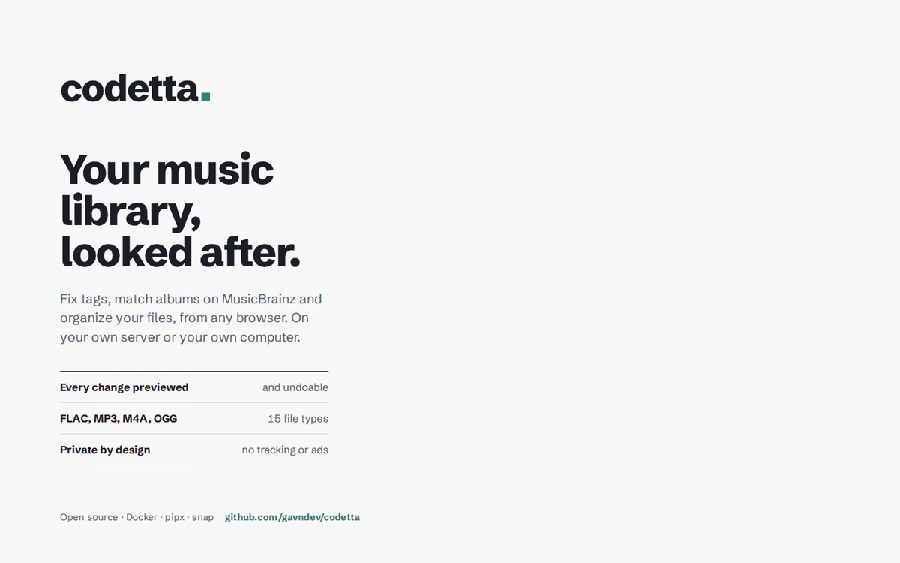
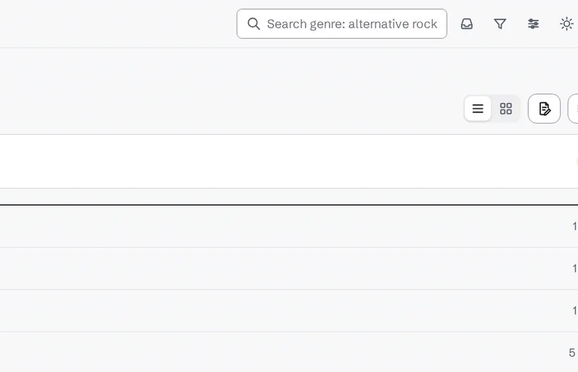

<p align="center">
  <picture>
    <source media="(prefers-color-scheme: dark)" srcset="docs/brand/logo-dark.svg">
    
  </picture>
</p>

<p align="center">
  <strong>Your music library, looked after. On your own server.</strong><br>
  Fix tags, match albums on MusicBrainz, organize your files and bring in new music,<br>
  from any browser, including your phone. FLAC, MP3, M4A, OGG, WAV, AIFF, WMA and more.
</p>

<p align="center">
  
  
  <a href="LICENSE"></a>
  
  <a href="https://github.com/gavndev/codetta/actions/workflows/ci.yml"></a>
  <a href="https://github.com/gavndev/codetta/pkgs/container/codetta"></a>
  
</p>

<p align="center">
  <picture>
    <source media="(prefers-color-scheme: dark)" srcset="docs/media/hero-dark.gif">
    
  </picture>
</p>

<p align="center">
  <a href="https://alternativeto.net/software/codetta/about/?utm_source=badge&utm_medium=referral"></a>
</p>

<p align="center">
  <a href="#quick-start">Quick start</a> ·
  <a href="#what-codetta-does">Features</a> ·
  <a href="#how-codetta-compares">Compare</a> ·
  <a href="#documentation">Docs</a> ·
  <a href="#whats-new-and-whats-next">What's new</a>
</p>

---

If you run your own music server, you know the drill: a SoundCloud download
with no tags, an album where every track spells the artist differently, a
folder of loose files that shows up as *Unknown Album*. I made Codetta for home server users like me who want finer control over their
library. It's my hobby project, and I thought it could be useful to others too.

Codetta lives on your server, next to your music. **Open it on your laptop or
your phone, pick a track or a whole album, fix what's wrong and hit Save.**
Match albums on MusicBrainz for official tags and cover art, rename and
organize files into tidy folders, and let new music from your downloads folder
be matched and filed for you. Your files are updated **safely**, anything
Codetta does can be **undone**, and [Navidrome](https://www.navidrome.org/)
and other music apps pick up the changes straight away (connect your server) or on their next scan.

> [!NOTE]
> **Codetta is in beta.** The latest, 0.14, puts every setting on one searchable Settings page.
> 0.13 completed music app support: Symfonium, Narjo, Arpeggi, Eclipse and other Subsonic apps get
> stars, playlists, a shared play queue, smaller files on mobile data and ListenBrainz scrobbling.
> Everything is in the [changelog](CHANGELOG.md). Codetta is careful with your files and used daily
> on real libraries, but keep a backup of your music, as you would with any tool that edits files.

> **Codetta is AI-Assisted.** I understand the controversy surrounding AI usage in software. I prioritize transparency, hence the disclaimer for those who do not favor AI. This project is assisted by Claude Opus 5.5.

## Quick start

On a server with [Docker](https://docs.docker.com/engine/install/):

```sh
mkdir codetta && cd codetta
curl -fsSLO https://raw.githubusercontent.com/gavndev/codetta/main/docker-compose.yml
cat > docker-compose.override.yml <<'EOF'
services:
  codetta:
    environment:
      PUID: "1000"   # the user that owns your music (ls -ln /path/to/music)
      PGID: "1000"
    volumes:
      - /path/to/your/music:/music
      # Optional: where new music lands (downloads, rips), for the inbox
      # - /path/to/downloads:/inbox
EOF
docker compose up -d
```

Open `http://<your-server>:8111` and create your account. A few short setup
steps follow (online features, folder naming, Tidy up, the inbox, optional
integrations). Each can be skipped and changed later.

Runs on Intel/AMD and ARM, from a Raspberry Pi 4 up: about a 40 MB download
and 70 MB of memory (about 130 MB at 100,000 tracks), and no disk activity when idle. The
[install guide](docs/install.md) walks through every step, including updates.

No server? Run it on your own computer instead: `pipx install codetta`
(or `sudo snap install codetta` on Ubuntu), then `codetta`
([details](docs/install.md#on-your-own-computer)).

## What Codetta does

### Fix tags, one track or a whole album

Select tracks and change only what you need, or fill in one track and **Save to folder** to apply
exactly those changes to the whole album, cover art included. You see every change before anything
is written. Tag tools handle the tedious parts: tags from file names, paste a tracklist, fix garbled
text, change case, lyrics, ReplayGain.

<p align="center">
  
</p>

### Match albums on MusicBrainz

Official titles, credits, dates, labels and cover art for any album folder, reviewed per file before
anything is written. Switch editions, set the edition you prefer, and match loose songs or untagged
files by sound. Discogs, Deezer and iTunes step in for albums MusicBrainz doesn't have.

<p align="center">
  
</p>

### Organize, tidy up, keep it healthy

- **Organize** renames and moves files from their tags with a pattern like `{albumartist}/{album} ({year})/{disctrack} {title}`, with a preview first.
- **Tidy up** works through the music you already have in the background, album by album, and writes only confident matches.
- **Library health** finds albums your player shows split in two, missing tracks and covers, and real duplicates, with one-tap fixes.

<p align="center">
  
</p>

### Bring in new music

Point Codetta at your downloads folder. It groups what arrives into albums, matches each one (by tags,
or by sound) and files it with your folder pattern, on its own or after a quick review. You can also
import from your computer or phone.

<p align="center">
  
</p>

### Search, and search beyond your library

Search the whole library by any tag (`genre: rap, hip-hop`, `artist: drake year: 2024`) and edit the
results like a folder. Start with a bang to search elsewhere from the same box: `!mb` MusicBrainz,
`!dg` Discogs, `!dz` Deezer, `!it` iTunes. Albums you already have are marked.

<p align="center">
  
</p>

### Safe and private by design

- **Verified writes:** every save goes to a temporary copy that's checked before it replaces the original.
- **Undo anything** from the activity log, across restarts. Deleted files wait 30 days in Recently deleted.
- **Offline by default:** no tracking or telemetry; every online service is off until you turn it on, and says exactly what it sends. See [PRIVACY.md](PRIVACY.md) and [SECURITY.md](SECURITY.md).

### Fits your setup

- **Music servers:** Navidrome, Subsonic servers, Jellyfin, Emby and Plex read Codetta's tags, and rescan straight after every change. [More →](docs/media-servers.md)
- **Lidarr:** rescans after Codetta's edits, and Codetta warns about settings that would undo them. [More →](docs/lidarr.md)
- **Autoplay:** when an album ends, similar songs from your library keep playing, picked by AudioMuse-AI, ListenBrainz or Deezer. [More →](docs/autoplay.md)
- **Music apps:** Symfonium, Narjo, Arpeggi, Feishin and other Subsonic apps can play your library straight from Codetta (opt-in, read-only). [More →](docs/music-apps.md)
- **Your phone:** big touch targets and a full-screen editor; add it to your home screen and it opens like an app.
- **Optional:** Soulseek through your own slskd. [More →](docs/features.md#soulseek-through-slskd)

[**See every feature →**](docs/features.md)

## How Codetta compares

| | **Codetta** | [Picard](https://picard.musicbrainz.org/) | [beets](https://beets.io/) | [Metadata Remote](https://github.com/wow-signal-dev/metadata-remote) |
|---|---|---|---|---|
| What it is | Web app on your server | Desktop app | Command line | Web app on your server |
| Use it from your phone | ✅ Designed for it | ❌ | ❌ | ➖ Responsive |
| Match on MusicBrainz | ✅ Reviewed per file | ✅ | ✅ On import | ➖ Suggestions |
| Import a downloads folder | ✅ Inbox | ❌ | ✅ `beet import` | ❌ |
| Organize files | ✅ Preview, undo | ✅ | ✅ | ✅ Rename |
| Undo | ✅ Across restarts | ❌ | ❌ | ✅ Until restart |
| License | AGPL-3.0 | GPL-2.0 | MIT | AGPL-3.0 |

[Full comparison →](docs/comparison.md)

## Documentation

**[Install & update](docs/install.md)** · **[Configuration](docs/configuration.md)** · **[Features](docs/features.md)** ·
**[FAQ](docs/faq.md)** · **[Architecture](ARCHITECTURE.md)** · **[Privacy](PRIVACY.md)** · **[Security](SECURITY.md)**

## What's new and what's next

Every change is in the [changelog](CHANGELOG.md) and on [GitHub Releases](https://github.com/gavndev/codetta/releases);
inside Codetta, **What's new** shows the notes for your version. What has to be true before 1.0 is on
[the road to 1.0](docs/road-to-1.0.md).

## Contributing

Bug reports, ideas and pull requests are all welcome. [Open an issue](https://github.com/gavndev/codetta/issues)
(even a quick "this confused me" helps), or read [CONTRIBUTING.md](CONTRIBUTING.md) and
[ARCHITECTURE.md](ARCHITECTURE.md) before writing code. Testing new releases and improving the docs
help just as much. Forks are welcome too; please give yours a different name.

## License

Codetta is free software under the [GNU AGPL v3.0](LICENSE) (or later): use it,
study it, change it and share it. If you run a modified version for others, you
must share your changes under the same license.

Codetta was created by Gavin Griggs.  
Copyright (C) 2026 Gavin Griggs and contributors.

## Thanks

To everyone who reported a bug or shaped a feature:

- [BernoldM](https://github.com/BernoldM): a detailed report on iTunes matching ([#3](https://github.com/gavndev/codetta/issues/3)) whose six suggestions all made it into Codetta

Found a bug or have an idea? [Open an issue](https://github.com/gavndev/codetta/issues) and you could be next on this list.

Codetta stands on [mutagen](https://github.com/quodlibet/mutagen), [FastAPI](https://fastapi.tiangolo.com/),
the [Schibsted Grotesk](https://github.com/schibsted/schibsted-grotesk) typeface and
[MusicBrainz Picard](https://picard.musicbrainz.org/docs/mappings/)'s tag mappings.

<sub>The header, screenshots and clips show real releases for illustration: the covers belong to their artists and labels, and the audio files are silent stand-ins.</sub>
