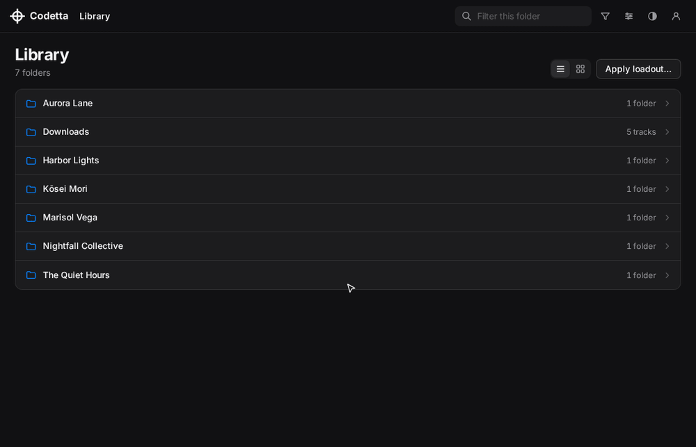
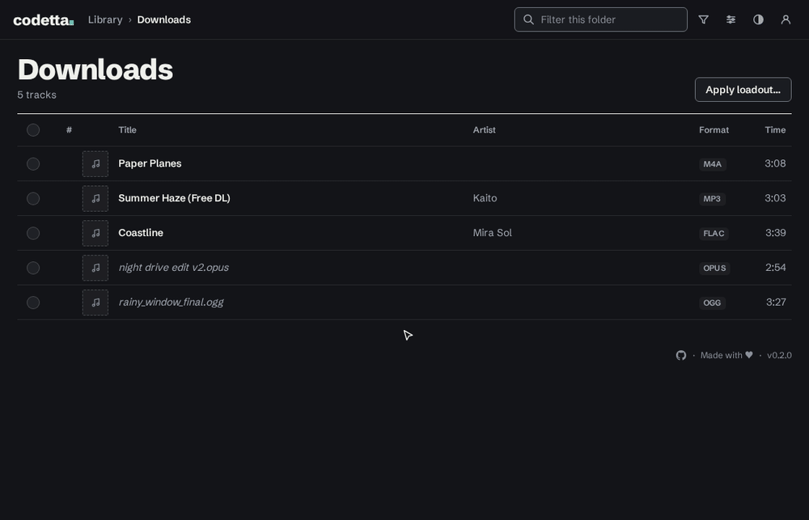
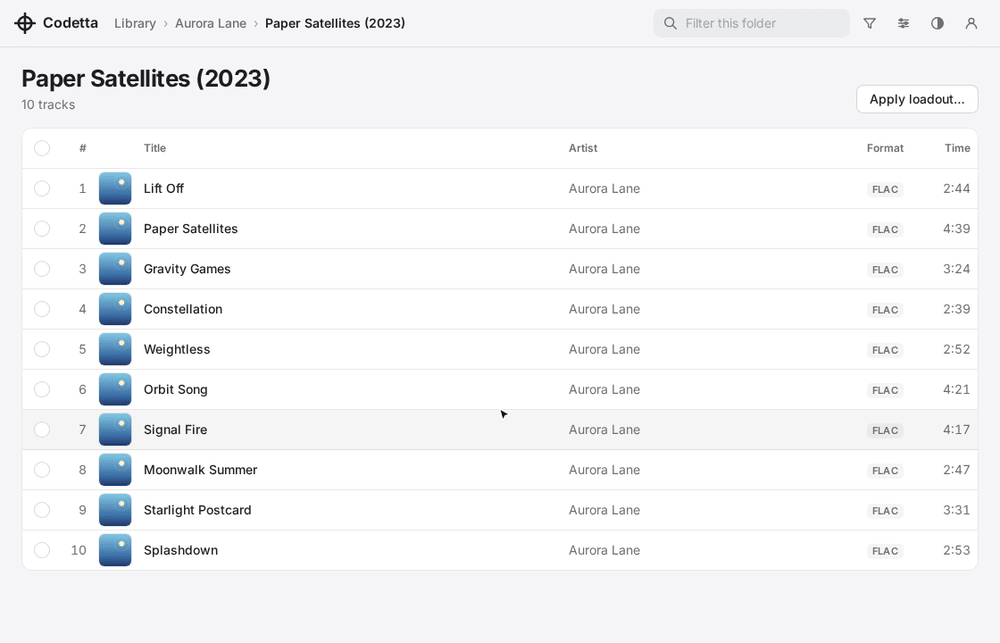
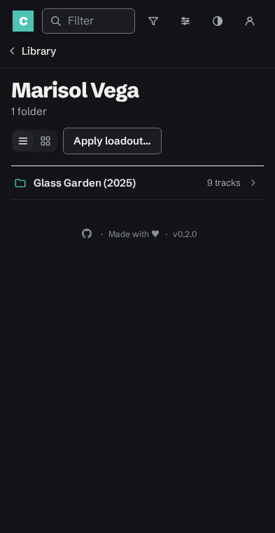
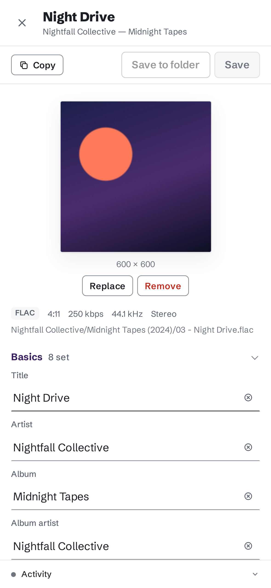
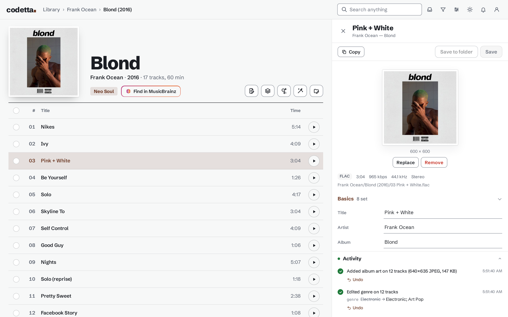

<p align="center">
  <picture>
    <source media="(prefers-color-scheme: dark)" srcset="docs/brand/logo-dark.svg">
    
  </picture>
</p>

<p align="center">
  <strong>Clean, self-hosted tag editing for your music library.</strong><br>
  Fix the tags on your FLAC, MP3, M4A, OGG and Opus files from any browser, including your phone.
</p>

<p align="center">
  
  
  <a href="LICENSE"></a>
  
  <a href="https://github.com/gavndev/codetta/actions/workflows/ci.yml"></a>
  <a href="https://github.com/gavndev/codetta/pkgs/container/codetta"></a>
  
</p>

<p align="center">
  
</p>

<p align="center">
  <a href="#quick-start">Quick start</a> ·
  <a href="#what-it-does">What it does</a> ·
  <a href="#installing">Installing</a> ·
  <a href="#settings">Settings</a> ·
  <a href="#faq">FAQ</a> ·
  <a href="#whats-new">What's new</a>
</p>

---

## Why Codetta?

If you run your own music server, you know the drill: a SoundCloud download
with no tags, an album where every track spells the artist differently, a
folder of loose files that shows up as *Unknown Album*. I created this tool for home server users like myself who are looking for more granular control over their library. Honestly, it's my hobby project that I thought could be useful to others.

Codetta lives on your server, next to your music. **Open it on your laptop or
your phone, pick a track or a whole album, fix what's wrong and hit Save.** Your
files are updated **safely**, and your music apps pick up the change on their next
scan.

It's built with [Navidrome](https://www.navidrome.org/) and other
OpenSubsonic servers in mind. Codetta writes the tags those apps actually show
(credits, mood, label, release type, multiple artists), in the same places
[MusicBrainz Picard](https://picard.musicbrainz.org/) does.

> **Codetta is alpha software.** It's careful with your files (see
> [how](#how-codetta-keeps-your-files-safe)), but it's young. Keep a backup of
> your library, as you would with any tool that edits files.

> **Codetta is AI-Assisted.** I understand the controversy surrounding AI usage in software. I prioritize transparency, hence the disclaimer for those who do not favor AI. This project is assisted by Claude Opus 5.5.

## Quick start

On a server with [Docker](https://docs.docker.com/engine/install/):

```sh
mkdir codetta && cd codetta
curl -fsSLO https://raw.githubusercontent.com/gavndev/codetta/main/docker-compose.yml
cat > docker-compose.override.yml <<'EOF'
services:
  codetta:
    environment:
      PUID: "1000"   # the user that owns your music (ls -ln /path/to/music)
      PGID: "1000"
    volumes:
      - /path/to/your/music:/music
EOF
docker compose up -d
```

Then open `http://<your-server>:8111` and create your account. That's it.
The ready-made image runs on Intel/AMD and ARM (e.g. Raspberry Pi) servers.
The [full guide](#installing) walks through each step.

## What it does

### Search your whole library

Type in the search box and press <kbd>Enter</kbd> to search every track you
own. Search by tag, and combine as much as you like:

| Type | Finds |
|---|---|
| `genre: rap, hip-hop` | tracks whose genre is Rap **or** Hip-Hop (but not "Trap") |
| `artist: drake` | everything by Drake, including features ("Drake & Future") |
| `genre: rap year: 2024` | both at once |
| `night drive` | those words in the title, artist, album or file name |

It ignores case and accents ("beyonce" finds "Beyoncé"). Results work like a
folder, so you can select them and edit them all at once. You can also start a
search from the filter button: pick a tag and a value, then **Search library**.

<p align="center">
  
</p>

### Fix a whole album in one go

Fill in the album details once, drop in a cover, and **Save to folder** applies
exactly those changes to every track. You see the full list of changes before
anything is written.

<p align="center">
  
</p>

### Turn loose downloads into proper releases

**Tag Loadouts** are saved sets of tags with placeholders like
`{filename_title}`, `{folder}` and `{track}/{tracktotal}`. Apply one to a file,
a selection or a folder, and loose downloads become properly tagged singles or
albums. You always get a preview first, and you choose whether to only fill
empty tags or overwrite them.

<p align="center">
  
</p>

### Undo anything

Every change lands in the activity log with its old and new values. Changed
your mind? Undo it right from the log, even across a whole album, and redo it
if you change it back. Files that were edited again since are left alone,
never overwritten.

<p align="center">
  
</p>

### Made for your phone too

Codetta is designed for iPhone and Android as much as for desktop: big touch
targets, a full-screen editor sheet, **Select** mode like the Photos app, and
covers straight from your photo library (HEIC included).

<p align="center">
  
  &nbsp;
  
  &nbsp;
  
</p>

### And the rest

- **Edit one track or many.** Select several tracks and change only the fields
  you need. Fields that differ show as *Multiple values* and are left alone
  unless you touch them.
- **Smart suggestions.** Album-level fields suggest values the other tracks in
  the folder already use, and Track suggests the file's position (`2/6`).
- **Copy & paste tags** between tracks and folders.
- **Album art everywhere.** A thumbnail on every track, and covers you can
  add, replace or remove as part of a normal save.
- **Filter a folder by tag**, e.g. *Label: Independent*.
- **Fast on big libraries.** Folders load one at a time, and search uses a
  small index that Codetta keeps up to date in the background, so even tens
  of thousands of tracks stay quick.
- **Any language, any script.** Japanese, Hindi, Korean, Thai, Arabic, accented
  names and emoji are saved exactly as typed. Search ignores accents
  ("beyonce" finds "Beyoncé") and right-to-left names display correctly.
- **Light and dark themes** that follow your device, with smooth, subtle
  animations (off when your system asks for reduced motion).
- **Works offline.** No CDNs, no tracking, fonts bundled. The only thing Codetta
  ever sends out is an optional check for new versions.

<p align="center">
  <picture>
    <source media="(prefers-color-scheme: dark)" srcset="docs/screenshots/editor-dark.png">
    
  </picture>
</p>

## How Codetta keeps your files safe

Your library matters, so Codetta is careful with it:

- **The original is never touched until the change is verified.** Each save
  goes to a temporary copy, which is read back to check that every tag landed
  correctly, then swapped in with a single atomic step. If anything goes wrong
  (a full disk, a crash, a power cut), the original file is left exactly as it
  was.
- **Nothing else changes.** Tags you didn't edit, embedded art, permissions
  and ownership are preserved. Symlinks are followed, not replaced, and
  hard-linked copies (say, a torrent that's still seeding) keep their
  original bytes.
- **Codetta only writes when you ask.** Browsing never modifies a file. Bulk
  actions ask you to confirm first, and everything can be undone.
- **It doesn't rename, move or delete files.** Only tags and embedded art
  change.
- **It's tested.** Over 500 automated tests cover every format, including
  corrupt, truncated and mislabelled files, every script and emoji, read-only
  folders, interrupted writes, simultaneous saves and attack attempts.

## Installing

You need a server with [Docker](https://docs.docker.com/engine/install/) and
Docker Compose, and your music in a folder on that server.

Codetta is light enough for starter hardware like a Raspberry Pi 4 and scales
to big libraries:

| | Typical |
|---|---|
| Download (image) | about 100 MB, for Intel/AMD and ARM |
| Memory | about 70 MB (a little more while it first reads your library) |
| Search index | about 2 KB per track (10 MB for 5,000 tracks) |
| When idle | no CPU and no disk activity, so your drives can sleep |

### 1. Back up your library

If you don't have a backup of your music yet, make one now. Codetta is
careful, but a backup protects you from the one thing no software can:
editing the wrong album.

### 2. Find the user that owns your music

Codetta runs as a normal user (never root), so the files it edits keep their
owner and your other apps can still read them:

```sh
ls -ln /path/to/your/music | head -3   # 3rd and 4th columns: user and group ID
```

On most single-user servers that's `1000` and `1000`.

### 3. Get Codetta

Make a folder for Codetta and download its compose file:

```sh
mkdir codetta && cd codetta
curl -fsSLO https://raw.githubusercontent.com/gavndev/codetta/main/docker-compose.yml
```

### 4. Point it at your music

Create `docker-compose.override.yml` next to `docker-compose.yml`, with your
own path and IDs:

```yaml
services:
  codetta:
    environment:
      PUID: "1000"   # from step 2
      PGID: "1000"
    volumes:
      - /path/to/your/music:/music
```

Keeping your settings in this separate file means updates never overwrite them.

### 5. Start it

```sh
docker compose up -d
```

Docker downloads the ready-made image (`ghcr.io/gavndev/codetta`), which
works on Intel/AMD and ARM servers. On a big library, the search index takes a
few minutes to build in the background; everything else works straight away.

### 6. Create your account

Open `http://<your-server>:8111` and choose a username and password (at least
8 characters). Do this right away. For safety, the setup screen only works
from your home network, Tailscale or the server itself.

### 7. Try it on one album first

Pick an album you know well, make a small change, and check it in your music
app after its next library scan. Happy? Then it's ready for the rest of your
library.

## Updating

Your version is shown on the sign-in screen and in the account menu (the
person icon). When a new release is out, a dot appears on that icon, and the
account menu shows what's new and the commands to run:

```sh
cd codetta
docker compose pull
docker compose up -d
```

To stay on a specific version, change `latest` in `docker-compose.yml` to a
version number such as `0.1.0`. Codetta never updates itself. That would mean giving it control of Docker,
and with it the rest of your server. Your account, loadouts and activity log
live in `./codetta-config` and are kept across updates.

## Settings

All optional. Set them under `environment:` in your
`docker-compose.override.yml`.

| Variable | Default | What it does |
|---|---|---|
| `PUID` / `PGID` | `1000` | The user and group Codetta runs as. Match your music files' owner. |
| `CODETTA_PORT` | `8111` | The port inside the container. To use a different port on your server, change the `ports:` mapping instead. |
| `CODETTA_USERNAME` + `CODETTA_PASSWORD` | – | Create the account from here instead of the setup screen. The password can then only be changed here. |
| `CODETTA_AUTH` | `on` | Set to `off` to disable sign-in. **Only** do this if a reverse proxy in front of Codetta already requires a login. |
| `CODETTA_UPDATE_CHECK` | `on` | Twice a day, asks GitHub whether a newer release exists. Nothing about you or your library is sent. Set to `off` to disable. |
| `CODETTA_ALLOW_PUBLIC_SETUP` | `off` | The setup screen only works from home networks, Tailscale and the server itself, so nobody on the internet can claim a fresh install. Set to `on` only if you must set up over the internet. |
| `CODETTA_ALLOWED_HOSTS` | – | Comma-separated host names Codetta answers to (e.g. `music-server,192.168.1.50`). Other names are refused, which blocks DNS-rebinding attacks. Recommended if more than your own devices can reach Codetta. |
| `FORWARDED_ALLOW_IPS` | `127.0.0.1` | Behind a reverse proxy, set this to the proxy's IP so login lockouts see each visitor's real address. |

| Folder in the container | What's in it |
|---|---|
| `/music` | Your library. Codetta needs read-write access to edit it. |
| `/config` | Your account, sessions, profile picture, loadouts, the activity log, previous album art kept for undo, and the search index (rebuilt automatically if deleted). Include it in your backups. |

The provided compose file also runs the container with a read-only system
filesystem and without the ability to gain extra privileges.

## Signing in

- Each browser stays signed in for 30 days.
- The person icon in the top bar lets you set a profile picture, change your
  password or sign out. Changing the password signs out your other devices.
- After 5 wrong passwords, that device has to wait before trying again
  (30 seconds, doubling each time, up to 15 minutes).

**Forgot your password?** Reset it from the server:

```sh
docker exec -it codetta codetta-admin set-password
```

You'll be asked for a new password, and every device is signed out. To sign
out every device without changing the password, use `codetta-admin sign-out-all`.

## Remote access and HTTPS

Codetta serves plain HTTP on port 8111. On your home network, or over
[Tailscale](https://tailscale.com/) (which already encrypts traffic between
your devices), that's fine.

**Don't expose Codetta directly to the internet.** If you want an `https://`
address:

- **Tailscale:** run `tailscale serve --bg 8111` on the server to get
  `https://<server>.<tailnet>.ts.net`, reachable only by your devices.
- **A reverse proxy** (Caddy, Traefik, nginx…): point it at port 8111. Codetta
  marks its session cookie `Secure` when the proxy sends
  `X-Forwarded-Proto: https`. A minimal Caddy example:

  ```
  codetta.example.com {
      reverse_proxy localhost:8111
  }
  ```

## Security

- Every page and API call requires signing in, except the sign-in screen and a health check.
- A fresh install can only be set up from your home network, Tailscale or the server itself.
- Passwords are hashed with scrypt; sessions are random tokens stored only as hashes; repeated wrong passwords are locked out.
- Changes must come from Codetta's own page (cross-site requests are refused), request sizes are capped, and every response carries a strict Content Security Policy.
- Album art from your files is only ever shown as an image, so a malicious file can't run code in your browser.
- The container runs as your user, with a read-only system filesystem and no extra privileges.
- Codetta only touches files inside the music folder. Symlinks *you* put there (e.g. to music on another disk) are followed; nothing in Codetta can create links, upload new files or delete tracks.
- Requests are bounded: at most 1,000 files and 100,000 characters per tag value per request, and a file listed twice is only edited once.

Found a security problem? Please report it privately through
[GitHub's security advisories](https://github.com/gavndev/codetta/security/advisories/new)
rather than in a public issue.

## Supported formats

| Format | Extensions | Notes |
|---|---|---|
| FLAC | `.flac` | Any tag name is allowed. |
| MP3 | `.mp3` | All of Codetta's fields. Saved as ID3v2.4, which Navidrome and modern players read; some older software prefers ID3v2.3. |
| AAC / ALAC | `.m4a` | All of Codetta's fields. |
| Ogg Vorbis | `.ogg` | Any tag name is allowed. |
| Opus | `.opus` | Any tag name is allowed. |

Codetta detects the real format from each file's contents, so a mislabelled
file still opens correctly.

## FAQ

**Does it work with Jellyfin, Plex or other players?**
Yes. Codetta writes standard tags that any player reads. It's tuned for
Navidrome's extra fields, but nothing about it is Navidrome-only.

**Does it rename or move my files?**
No. Only tags and embedded album art change. File names and folders stay as
they are.

**How do I search for a tag that isn't in the list?**
Any tag name in your files works, e.g. `catalognumber: ABC-123`, or a custom
tag like `vibe: chill`. Separate several values with commas to match any of them.

**Does it need internet access?**
No. Everything, fonts included, is served from your own server. The optional
update check is the only outgoing request, and you can turn it off.

**Can several people use it?**
There's one account per Codetta instance for now. You can stay signed in on as
many devices as you like.

**My music app doesn't show the change yet.**
Most servers only notice changes on their next library scan. Start a scan in
your music app, or wait for the scheduled one.

**What if something goes wrong during a save?**
The original file is only replaced after the edited copy has been checked, so
an interrupted save leaves the original as it was. You can also undo any
change from the activity log.

## Known limitations

- One account per Codetta instance.
- WAV, AIFF, WMA and raw `.aac` files aren't supported.
- Custom tag names (beyond Codetta's field list) only work in FLAC, Ogg and Opus files.

## Roadmap

Ideas, roughly in order. Nothing here is promised, and suggestions are welcome.

- **MusicBrainz:** match a track or folder to a MusicBrainz release and fill
  in its official metadata (titles, credits, dates, label, IDs, cover art),
  with a preview first.
- **Last.fm:** genre tags, similar artists and listener counts as another
  source of suggestions.
- **Preview player:** listen to a track right in the browser to check it's
  the right one before you tag it.
- **Auto-organize (optional):** a toggle that files newly added music into
  tidy `Artist/Album/Track` folders based on its tags.
- **slskd integration (a big one):** find music you want through
  [slskd](https://github.com/slskd/slskd) and have it downloaded, tagged and
  added to your library in one go.

## What's new

### 0.1.0 (first release, alpha)

The first public version: editing for five formats, Save to folder, album art,
Tag Loadouts, undo and redo, sign-in, phone support and a hardened Docker
setup. See [**CHANGELOG.md**](CHANGELOG.md) for the full list and every
release after it.

## Removing Codetta

```sh
cd codetta
docker compose down
docker image rm ghcr.io/gavndev/codetta
```

Your music is never deleted. Remove the `codetta-config` folder too if you
don't want to keep your account, loadouts and activity log.

## Development

Codetta is a [FastAPI](https://fastapi.tiangolo.com/) app using
[mutagen](https://mutagen.readthedocs.io/) for tags, with a plain
HTML/CSS/JavaScript front end (no framework, no build step).

```sh
python3 -m venv .venv && source .venv/bin/activate
pip install -e ".[dev]"
pytest
CODETTA_MUSIC_DIR=~/some-test-music uvicorn codetta.web.app:app --reload --port 8111
```

To build the Docker image yourself instead of downloading it, add this to
your `docker-compose.override.yml` and run `docker compose up -d --build`:

```yaml
services:
  codetta:
    build: .
    image: codetta:local
```

Always use a **copy** of some music while developing. Contributor notes are in
[`CLAUDE.md`](CLAUDE.md), the plan in [`PLAN.md`](PLAN.md), and logo files and
colours in [`docs/brand`](docs/brand).

## License

Codetta is free software under the [GNU Affero General Public License v3.0](LICENSE)
(AGPL-3.0-or-later). You can use, study, change and share it. If you run a
modified version for other people, including as a hosted service, you must
make your changes available to them under the same license.

## Credits

- [mutagen](https://github.com/quodlibet/mutagen) for reading and writing tags.
- [FastAPI](https://fastapi.tiangolo.com/) and [Uvicorn](https://www.uvicorn.org/).
- [Inter](https://rsms.me/inter/) by Rasmus Andersson, under the SIL Open Font License.
- Tag mappings follow [MusicBrainz Picard](https://picard.musicbrainz.org/docs/mappings/)'s conventions.
- The artists and albums in the screenshots are made up.
