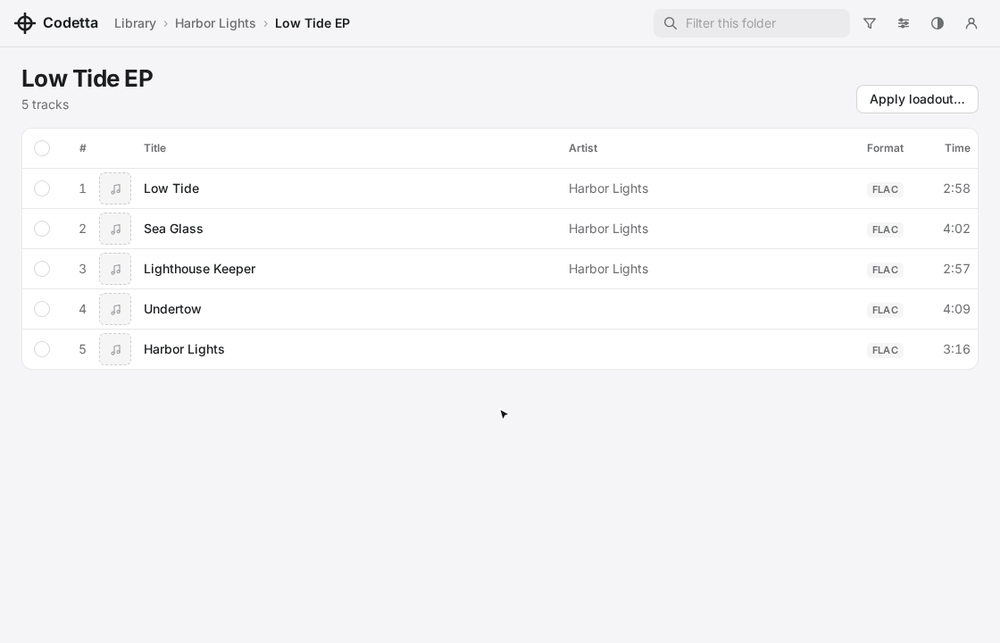

<p align="center">
  <picture>
    <source media="(prefers-color-scheme: dark)" srcset="docs/brand/logo-dark.svg">
    
  </picture>
</p>

<p align="center">
  <strong>Clean, self-hosted tag editing for your music library.</strong><br>
  Fix the tags on your FLAC, MP3, M4A, OGG, WAV, AIFF, WMA and more, from any browser, including your phone.
</p>

<p align="center">
  
  
  <a href="LICENSE"></a>
  
  <a href="https://github.com/gavndev/codetta/actions/workflows/ci.yml"></a>
  <a href="https://github.com/gavndev/codetta/pkgs/container/codetta"></a>
  
</p>

<p align="center">
  
</p>

<p align="center">
  <a href="#quick-start">Quick start</a> ·
  <a href="#what-codetta-does-best">Features</a> ·
  <a href="#how-codetta-compares">Compare</a> ·
  <a href="#documentation">Docs</a> ·
  <a href="#roadmap">Roadmap</a>
</p>

---

If you run your own music server, you know the drill: a SoundCloud download
with no tags, an album where every track spells the artist differently, a
folder of loose files that shows up as *Unknown Album*. I created this tool for home server users like myself who are looking for more granular control over their library. Honestly, it's my hobby project that I thought could be useful to others.

Codetta lives on your server, next to your music. **Open it on your laptop or
your phone, pick a track or a whole album, fix what's wrong and hit Save.** Your
files are updated **safely**, and [Navidrome](https://www.navidrome.org/) and
other music apps pick up the change on their next scan.

> **Codetta is alpha software.** It's careful with your files, but it's young.
> Keep a backup of your library, as you would with any tool that edits files.

> **Codetta is AI-Assisted.** I understand the controversy surrounding AI usage in software. I prioritize transparency, hence the disclaimer for those who do not favor AI. This project is assisted by Claude Opus 5.5.

## Quick start

On a server with [Docker](https://docs.docker.com/engine/install/):

```sh
mkdir codetta && cd codetta
curl -fsSLO https://raw.githubusercontent.com/gavndev/codetta/main/docker-compose.yml
cat > docker-compose.override.yml <<'EOF'
services:
  codetta:
    environment:
      PUID: "1000"   # the user that owns your music (ls -ln /path/to/music)
      PGID: "1000"
    volumes:
      - /path/to/your/music:/music
EOF
docker compose up -d
```

Open `http://<your-server>:8111` and create your account. That's it.

Runs on Intel/AMD and ARM, from a Raspberry Pi 4 up: about a 100 MB download
and 70 MB of memory, and no disk activity when idle. The
[install guide](docs/install.md) walks through every step, including updates.

## What Codetta does best

### Fix a whole album in one go

Select tracks and change only what you need, or fill in one track and
**Save to folder** to apply exactly those changes to the whole album, cover
art included. You see every change before anything is written.

<p align="center">
  
</p>

### Search your entire library by tag

Type in the search box and press <kbd>Enter</kbd>. Results work like a folder,
so you can edit them all at once.

| Type | Finds |
|---|---|
| `genre: rap, hip-hop` | Rap **or** Hip-Hop (but not "Trap") |
| `artist: drake year: 2024` | both at once |
| `night drive` | words in the title, artist, album or file name |

<p align="center">
  
</p>

### Safe by design

- **Verified writes.** Every save goes to a temporary copy that's checked
  before it replaces the original, so a crash or full disk can't damage a file.
- **Undo anything** from the activity log, even across a whole album, and it's
  kept across restarts.
- **Only tags change.** Codetta never renames, moves or deletes your files.
- **Private by default.** Built-in sign-in, a strict security setup, and it
  runs as your user. See [SECURITY.md](SECURITY.md).

### Made for your phone

<p align="center">
  
  &nbsp;
  
</p>

**Also:** lyrics (plain or synced, with **Find lyrics** from LRCLIB), sort and
classical fields, an Advanced mode with the raw tags, Tag Loadouts for turning
loose downloads into proper releases, smart
suggestions from the rest of the album, copy & paste tags, every field
Navidrome shows (credits, mood, label, release type, multiple artists), any
language and script, light and dark themes. [See every feature →](docs/features.md)

## How Codetta compares

| | **Codetta** | [MusicBrainz Picard](https://picard.musicbrainz.org/) | [beets](https://beets.io/) | [Metadata Remote](https://github.com/wow-signal-dev/metadata-remote) |
|---|---|---|---|---|
| What it is | Web app on your server | Desktop app | Command-line library manager | Web app on your server |
| Use it from your phone | ✅ Designed for it | ❌ | ❌ | ➖ Responsive layout |
| Runs in Docker | ✅ Official image | ➖ Community images | ➖ Community images | ✅ Official image |
| Built-in sign-in | ✅ | – (local app) | – (local app) | ❌ Use a reverse proxy |
| Edit tags by hand, one track or many | ✅ | ✅ | ➖ `beet modify` | ✅ |
| Album art | ✅ | ✅ + Cover Art Archive | ✅ via plugin | ✅ |
| Match releases on MusicBrainz | ❌ Planned | ✅ Incl. audio fingerprints | ✅ Automatic on import | ➖ Suggestions |
| Undo | ✅ Kept across restarts | ❌ | ❌ | ✅ Until restart |
| Search the whole library by tag | ✅ | ➖ | ✅ Query language | ➖ Filtering |
| Rename / organize files | ❌ By design (optional auto-organize planned) | ✅ | ✅ | ✅ Rename |
| Play tracks | ❌ Planned | ➖ Basic player | ➖ Via external player | ✅ In the browser |
| Plugins | ❌ Planned | ✅ | ✅ | ❌ |
| Formats | 15 file types | 20+ | Most common formats | 9 |
| License | AGPL-3.0 | GPL-2.0 | MIT | AGPL-3.0 |

✅ yes · ➖ partly or with extra setup · ❌ no

**Picard** is the best at matching files to MusicBrainz. **beets** is the best
at automatically importing and organizing big collections from a terminal.
**Metadata Remote** is a lightweight web editor with a player and renaming.
**Codetta** is for fixing tags by hand from any browser, safely, and works
well alongside Picard or beets.

<sub>Compared in November 2026 from each project's documentation. Spotted something out of date? Please [open an issue](https://github.com/gavndev/codetta/issues).</sub>

## Documentation

- **[Install & update](docs/install.md)**: step by step, updating, password reset, removing
- **[Configuration](docs/configuration.md)**: settings, HTTPS and remote access
- **[Features](docs/features.md)**: everything Codetta does, supported formats
- **[FAQ](docs/faq.md)**: common questions and known limitations
- **[Security](SECURITY.md)** · **[Changelog](CHANGELOG.md)** · **[Contributing](CONTRIBUTING.md)**

## Roadmap

- **MusicBrainz:** match a release and fill in its official metadata, with a preview.
- **Last.fm:** genres and similar artists as another source of suggestions.
- **Preview player:** listen to a track before you tag it.
- **Auto-organize (optional):** file new music into `Artist/Album/Track` folders.
- **slskd integration:** find music, download, tag and add it to your library in one go.

## What's new

**0.3.0:** a new look, "liner notes": new logo and typeface, each album borrows a colour
from its cover, album pages read like a booklet, and the editor like a credits sheet.
**0.2.0:** 10 more formats (WAV, AIFF, DSF, WMA, WavPack and more), lyrics with
**Find lyrics**, sort and classical fields, and an Advanced mode with raw tags.
**0.1.1:** a quiet footer with a GitHub link and the version, a comparison with
similar tools, and a shorter README with separate docs.
**0.1.0:** the first public alpha. All changes are in the [changelog](CHANGELOG.md).

## License

Codetta is free software under the [GNU AGPL v3.0](LICENSE) (or later): use it,
study it, change it and share it. If you run a modified version for others, you
must share your changes under the same license.

Built with [mutagen](https://github.com/quodlibet/mutagen),
[FastAPI](https://fastapi.tiangolo.com/) and the
[Schibsted Grotesk](https://github.com/schibsted/schibsted-grotesk) typeface.
Tag mappings follow [MusicBrainz Picard](https://picard.musicbrainz.org/docs/mappings/).
The artists and albums in the screenshots are made up.
