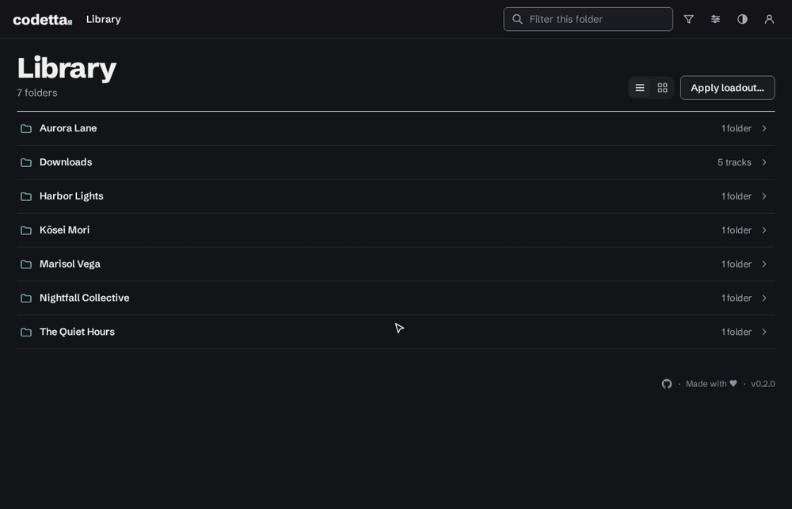
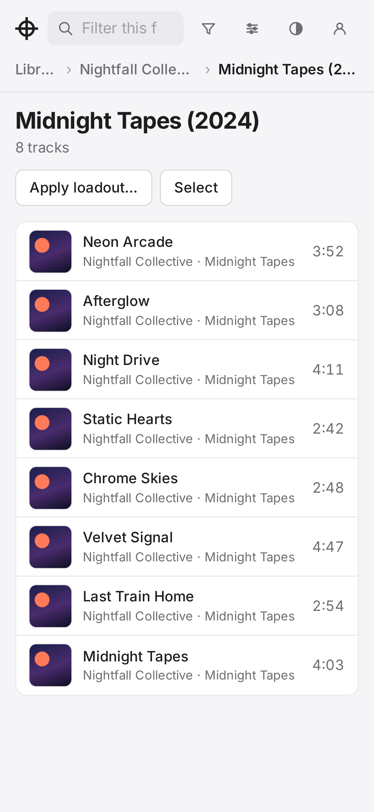

<p align="center">
  <picture>
    <source media="(prefers-color-scheme: dark)" srcset="docs/brand/logo-dark.svg">
    
  </picture>
</p>

<p align="center">
  <strong>Your music library, looked after. On your own server.</strong><br>
  Find music on Soulseek, match it on MusicBrainz, fix the tags and file it into place,<br>
  from any browser, including your phone. FLAC, MP3, M4A, OGG, WAV, AIFF, WMA and more.
</p>

<p align="center">
  
  
  <a href="LICENSE"></a>
  
  <a href="https://github.com/gavndev/codetta/actions/workflows/ci.yml"></a>
  <a href="https://github.com/gavndev/codetta/pkgs/container/codetta"></a>
  
</p>

<p align="center">
  
</p>

<p align="center">
  <a href="#quick-start">Quick start</a> ·
  <a href="#what-codetta-does">Features</a> ·
  <a href="#how-codetta-compares">Compare</a> ·
  <a href="#documentation">Docs</a> ·
  <a href="#roadmap">Roadmap</a>
</p>

---

If you run your own music server, you know the drill: a SoundCloud download
with no tags, an album where every track spells the artist differently, a
folder of loose files that shows up as *Unknown Album*. I created this tool for home server users like myself who are looking for more granular control over their library. Honestly, it's my hobby project that I thought could be useful to others.

It started as a tag editor and grew into the whole trip a record takes into
your library. Codetta lives on your server, next to your music:

**Find** an album on Soulseek (through your own slskd) → it lands in the
**inbox** → Codetta **matches** it on MusicBrainz → you take a look → it's
**tagged and filed** into your library with your folder pattern →
[Navidrome](https://www.navidrome.org/) and other music apps pick it up on
their next scan.

Every step is optional, and each works on its own: open Codetta on your laptop
or phone, pick a track or a whole album, fix what's wrong and hit Save. Your
files are updated **safely**, and anything Codetta does can be **undone**.

> **Codetta is alpha software.** It's careful with your files, but it's young.
> Keep a backup of your library, as you would with any tool that edits files.

> **Codetta is AI-Assisted.** I understand the controversy surrounding AI usage in software. I prioritize transparency, hence the disclaimer for those who do not favor AI. This project is assisted by Claude Opus 5.5.

## Quick start

On a server with [Docker](https://docs.docker.com/engine/install/):

```sh
mkdir codetta && cd codetta
curl -fsSLO https://raw.githubusercontent.com/gavndev/codetta/main/docker-compose.yml
cat > docker-compose.override.yml <<'EOF'
services:
  codetta:
    environment:
      PUID: "1000"   # the user that owns your music (ls -ln /path/to/music)
      PGID: "1000"
    volumes:
      - /path/to/your/music:/music
      # Optional: where new music lands (slskd's downloads, rips), for the inbox
      # - /path/to/downloads:/inbox
EOF
docker compose up -d
```

Open `http://<your-server>:8111` and create your account. A few short setup
steps follow (online features, folder naming, the inbox, Soulseek). Each can
be skipped and changed later.

Runs on Intel/AMD and ARM, from a Raspberry Pi 4 up: about a 100 MB download
and 70 MB of memory, and no disk activity when idle. The
[install guide](docs/install.md) walks through every step, including updates.

## What Codetta does

### Get music: Soulseek through your slskd

If you run [slskd](https://github.com/slskd/slskd), type `!slskd` in the
search bar. It turns into a little **slskd** chip, and whatever you type next
goes to Soulseek (`*` works as a wildcard for filtered names). Or press
**Find in slskd** on an album to look for a better copy.

Codetta picks the best copy for you (lossless first, then free upload slots,
queue and speed), downloads it into your inbox with a progress bar, and asks
before it joins your library: **Import**, **Blocklist & try next**, or choose
another one. Search, download and import in one place, without a separate
Lidarr or beets setup.

### An inbox for everything new

Point Codetta at your downloads folder. It groups what's there into albums,
waits until downloads finish, finds each on **MusicBrainz** (by its tags, or
**by sound** with AcoustID) and files it with your folder pattern. Confident
matches can file themselves; the rest wait for a quick review. Albums you
already have are never overwritten.

### Match on MusicBrainz

Official titles, credits, dates, labels, catalog numbers, MusicBrainz IDs and
cover art for any album folder. Compare editions, then review every change per
file before anything is written. Untagged files are recognised by sound.

### Fix a whole album in one go

Select tracks and change only what you need, or fill in one track and
**Save to folder** to apply exactly those changes to the whole album, cover
art included. You see every change before anything is written.

<p align="center">
  
</p>

### Search your entire library by tag

Type in the search box and press <kbd>Enter</kbd>. Results work like a folder,
so you can edit them all at once.

| Type | Finds |
|---|---|
| `genre: rap, hip-hop` | Rap **or** Hip-Hop (but not "Trap") |
| `artist: drake year: 2024` | both at once |
| `night drive` | words in the title, artist, album or file name |

<p align="center">
  
</p>

### Organize, listen, stay in the loop

- **Organize** renames and moves files from their tags with a pattern like
  `{albumartist}/{album} ({year})/{disctrack} {title}`, with a preview of every
  move first.
- **Quick listen:** a play button on every track and a now-playing pill, so you
  can check what a file is before you tag it.
- **Notifications** tell you when the inbox has something for you, an album
  filed itself, or an update is out.

### Safe by design

- **Verified writes.** Every save goes to a temporary copy that's checked
  before it replaces the original, so a crash or full disk can't damage a file.
- **Nothing moves without your say-so.** Organize and the inbox show every
  move first and never overwrite a file; an album you replace is kept aside.
- **Undo anything** from the activity log (tags, covers, moves, a whole
  album), and it's kept across restarts.
- **Offline unless you opt in.** MusicBrainz, AcoustID, lyrics, Soulseek and
  the update check are *connections*: each is off until you turn it on, and
  each says exactly what it sends.
- **Private by default.** Built-in sign-in, a strict security setup, and it
  runs as your user. See [SECURITY.md](SECURITY.md).

### Made for your phone

<p align="center">
  
  &nbsp;
  
</p>

**Also:** lyrics (plain or synced, with **Find lyrics** from LRCLIB), sort and
classical fields, an Advanced mode with the raw tags, Tag Loadouts for turning
loose downloads into proper releases, smart suggestions from the rest of the
album, copy & paste tags, every field Navidrome shows (credits, mood, label,
release type, multiple artists), multi-disc albums, any language and script,
light and dark themes. [See every feature →](docs/features.md)

## How Codetta compares

| | **Codetta** | [MusicBrainz Picard](https://picard.musicbrainz.org/) | [beets](https://beets.io/) | [Metadata Remote](https://github.com/wow-signal-dev/metadata-remote) |
|---|---|---|---|---|
| What it is | Web app on your server | Desktop app | Command-line library manager | Web app on your server |
| Use it from your phone | ✅ Designed for it | ❌ | ❌ | ➖ Responsive layout |
| Runs in Docker | ✅ Official image | ➖ Community images | ➖ Community images | ✅ Official image |
| Built-in sign-in | ✅ | – (local app) | – (local app) | ❌ Use a reverse proxy |
| Edit tags by hand, one track or many | ✅ | ✅ | ➖ `beet modify` | ✅ |
| Album art | ✅ + Cover Art Archive | ✅ + Cover Art Archive | ✅ via plugin | ✅ |
| Match releases on MusicBrainz | ✅ Opt-in, incl. audio fingerprints, reviewed per file | ✅ Incl. audio fingerprints | ✅ Automatic on import | ➖ Suggestions |
| Import new music (match and file a downloads folder) | ✅ Inbox, reviewed or automatic | ❌ | ✅ `beet import` | ❌ |
| Find and download music | ✅ Soulseek, through your slskd | ❌ | ❌ | ❌ |
| Rename / organize files | ✅ Pattern, preview, undo | ✅ | ✅ | ✅ Rename |
| Undo | ✅ Kept across restarts | ❌ | ❌ | ✅ Until restart |
| Search the whole library by tag | ✅ | ➖ | ✅ Query language | ➖ Filtering |
| Play tracks | ✅ In the browser | ➖ Basic player | ➖ Via external player | ✅ In the browser |
| Plugins | ➖ Opt-in connections (MusicBrainz, AcoustID, LRCLIB, slskd) | ✅ | ✅ | ❌ |
| Formats | 15 file types | 20+ | Most common formats | 9 |
| License | AGPL-3.0 | GPL-2.0 | MIT | AGPL-3.0 |

✅ yes · ➖ partly or with extra setup · ❌ no

**Codetta takes your music from scattered files to a well-organized library in one place.** It covers the whole trip (find, import, match, fix, and file) right from your browser, and you can see and approve each step along the way. No terminal or desktop install is needed, and nothing changes without you seeing it first.

<sub>Compared in November 2026 from each project's documentation. Spotted something out of date? Please [open an issue](https://github.com/gavndev/codetta/issues).</sub>

## Documentation

- **[Install & update](docs/install.md)**: step by step, updating, password reset, removing
- **[Configuration](docs/configuration.md)**: settings, connections (incl. slskd), HTTPS and remote access
- **[Features](docs/features.md)**: everything Codetta does, supported formats
- **[FAQ](docs/faq.md)**: common questions and known limitations
- **[Security](SECURITY.md)** · **[Changelog](CHANGELOG.md)** · **[Contributing](CONTRIBUTING.md)**

## Roadmap

- **Batch matching:** match many albums at once in the background, review the uncertain ones later.
- **Library health:** one page of fixable problems (no cover, no MusicBrainz IDs, duplicates, missing tracks, with Find in slskd for the gaps).
- **Edition preferences:** your preferred country, format (digital or CD) and release type when matching.
- **Refresh from MusicBrainz:** pick up corrections made since an album was matched.
- **ReplayGain:** volume levelling, opt-in.

## What's new

**0.6.0:** Soulseek through your slskd (`!slskd` in the search bar, Find in
slskd on albums, review or automatic import, blocklist & try next, upgrades),
download progress in the inbox, and a roomier top bar on phones.
**0.5.0:** the import inbox, Organize (rename and move from a pattern), quick
listen with a now-playing pill, multi-disc albums, setup steps, What's new and
notifications.
**0.4.0:** offline unless you opt in; Match on MusicBrainz and identify by
sound with AcoustID. All changes are in the [changelog](CHANGELOG.md).

## License

Codetta is free software under the [GNU AGPL v3.0](LICENSE) (or later): use it,
study it, change it and share it. If you run a modified version for others, you
must share your changes under the same license.

Built with [mutagen](https://github.com/quodlibet/mutagen),
[FastAPI](https://fastapi.tiangolo.com/) and the
[Schibsted Grotesk](https://github.com/schibsted/schibsted-grotesk) typeface.
Tag mappings follow [MusicBrainz Picard](https://picard.musicbrainz.org/docs/mappings/).
Soulseek support talks to [slskd](https://github.com/slskd/slskd) over its API.
The artists and albums in the screenshots are made up.
