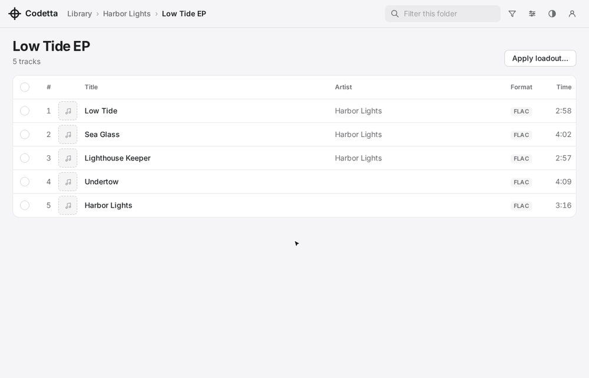
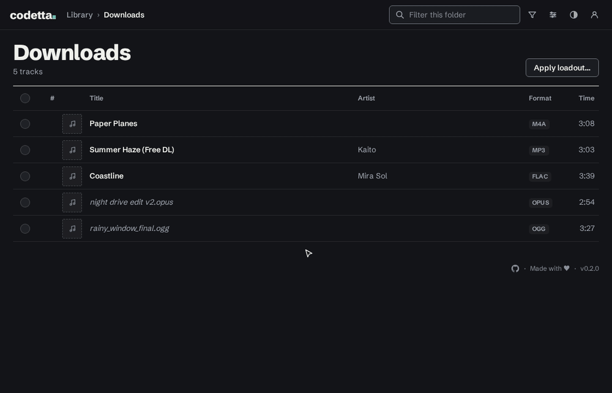
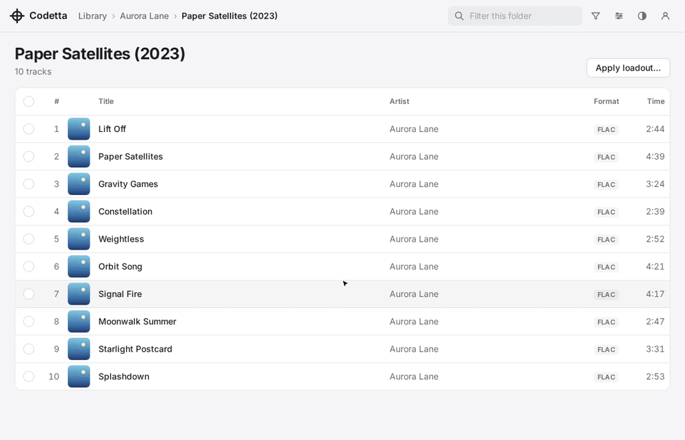
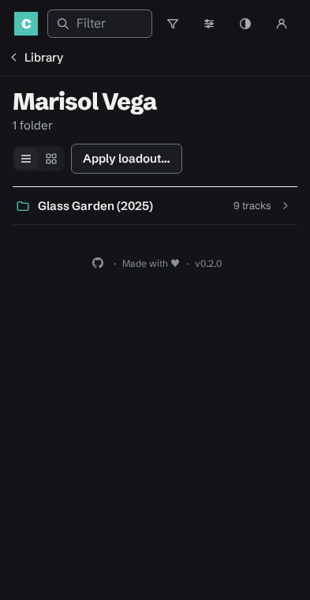
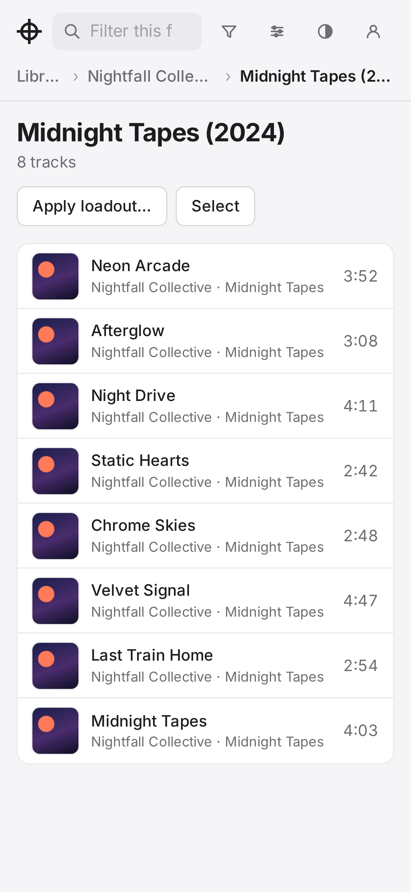

[← Back to the README](../README.md)

# Features

Everything Codetta does, in detail.

## Search your whole library

Type in the search box and press <kbd>Enter</kbd> to search every track you
own. Search by tag, and combine as much as you like:

| Type | Finds |
|---|---|
| `genre: rap, hip-hop` | tracks whose genre is Rap **or** Hip-Hop (but not "Trap") |
| `artist: drake` | everything by Drake, including features ("Drake & Future") |
| `genre: rap year: 2024` | both at once |
| `night drive` | those words in the title, artist, album or file name |

It ignores case and accents ("beyonce" finds "Beyoncé"). Results work like a
folder, so you can select them and edit them all at once. You can also start a
search from the filter button: pick a tag and a value, then **Search library**.

  

## Fix a whole album in one go

Fill in the album details once, drop in a cover, and **Save to folder** applies
exactly those changes to every track. You see the full list of changes before
anything is written.

  

## Turn loose downloads into proper releases

**Tag Presets** are saved sets of tags with placeholders like
`{filename_title}`, `{folder}` and `{track}/{tracktotal}`. Apply one to a file,
a selection or a folder, and loose downloads become properly tagged singles or
albums. You always get a preview first, and you choose whether to only fill
empty tags or overwrite them.

  

## Undo anything

Every change lands in the activity log with its old and new values. Changed
your mind? Undo it right from the log, even across a whole album, and redo it
if you change it back. Files that were edited again since are left alone,
never overwritten.

  

## Made for your phone too

Codetta is designed for iPhone and Android as much as for desktop: big touch
targets, a full-screen editor sheet, **Select** mode like the Photos app, and
covers straight from your photo library (HEIC included).

  
  &nbsp;
  
  &nbsp;
  

## And the rest

- **Edit one track or many.** Select several tracks and change only the fields
  you need. Fields that differ show as *Multiple values* and are left alone
  unless you touch them.
- **Smart suggestions.** Album-level fields suggest values the other tracks in
  the folder already use, and Track suggests the file's position (`2/6`).
- **Copy & paste tags** between tracks and folders.
- **Album art everywhere.** A thumbnail on every track, and covers you can
  add, replace or remove as part of a normal save.
- **Filter a folder by tag**, e.g. *Label: Independent*.
- **Fast on big libraries.** Folders load one at a time, and search uses a
  small index that Codetta keeps up to date in the background, so even tens
  of thousands of tracks stay quick.
- **Any language, any script.** Japanese, Hindi, Korean, Thai, Arabic, accented
  names and emoji are saved exactly as typed. Search ignores accents
  ("beyonce" finds "Beyoncé") and right-to-left names display correctly.
- **Light and dark themes** that follow your device, with smooth, subtle
  animations (off when your system asks for reduced motion).
- **Offline unless you opt in.** No CDNs, no tracking, fonts bundled. Online
  features (MusicBrainz, identify by sound, lyrics, the update check) stay off until you turn them
  on, and each one tells you exactly what it sends and where.

  <picture>
    <source media="(prefers-color-scheme: dark)" srcset="screenshots/editor-dark.png">
    
  </picture>

## Match albums on MusicBrainz

Turn on the MusicBrainz connection, open an album folder and press **Find in
MusicBrainz**. Codetta lists the editions that fit (year, country, format,
label, catalog number, track count and a match score). Already-tagged albums
offer their own release first, and you can paste any musicbrainz.org release
link instead of searching.

Pick a release, and the review screen shows every file next to the track it was
paired with. Pairing uses disc and track numbers first, then title and length,
and flags anything that looks off. You can choose:

- **Which fields**: titles and numbering, credits (composer, lyricist,
  producer, engineer, mixer, arranger, conductor), release details (original
  date, type, status, country, label, catalog number, barcode, media), sort
  names, MusicBrainz IDs and ISRCs, and community genres (off by default).
- **Replace or only fill empty** tags.
- **Cover art** from the Cover Art Archive: where missing, replace all, or leave.
- **Which track each file gets**, or leave a file alone.

Each file shows its old → new values before anything is written, and the
whole match is one undoable entry in the activity log. Tags are stored the way
MusicBrainz Picard writes them.

**Untagged or mystery files?** Turn on the AcoustID connection and press
**Listen** in the match dialog. Codetta fingerprints each track on your server
(only that short code and the length go to [AcoustID](https://acoustid.org)),
finds the releases holding most of them, and pairs every file with its exact
recording, whatever its name or track number says.

Running your own MusicBrainz mirror? Point `CODETTA_MUSICBRAINZ_URL` at it and
lookups stay on your network with no rate limit.

## Organize your files

**Organize…** renames and moves the files in a folder (or your selection) from
their tags, using a pattern such as

    {albumartist|artist}/{album}[ ({year})]/{disctrack} {title}

which gives `Kōsei Mori/Northern Signal (2021)/03 Harbour Lights.flac`
(`2-03` on multi-disc albums). `{a|b}` uses the first tag that has a value,
`[ … ]` disappears when a tag in it is empty, and `/` starts a folder. Pick a
starting pattern, tap tag buttons to build your own, and watch the live example.

You see every move before anything happens. Codetta never overwrites a file:
if a name is taken, that file is listed and left alone. Lyrics files
(`song.lrc`) follow their song, and when a whole album folder moves, its cover,
booklet, logs and scans come along. Folders left empty are removed. The whole
organize is one entry in the activity log, so **Undo** puts everything back.

## Library health

A card at the top of the Library page says how many things are worth a look
("23 things to look at"). It opens one list, grouped by kind:

- **Shows up split in your player:** an album whose tracks spell the album
  name, album artist or year differently, or that has features but no album
  artist (so Navidrome shows one album as several).
- **Tracks:** missing tracks (gaps, or fewer than the album's track total),
  the same track number twice, a multi-disc album with tracks missing their
  disc number.
- **Covers:** no cover at all (embedded or a cover image in the folder), or
  one smaller than 500 pixels.
- **Tags & files:** tracks without a title, artist, album or track number, the
  same album in two folders, the same song twice, unreadable files, and lossy
  files (MP3, AAC) inside an otherwise lossless album.

Where the fix is obvious there's a button for it ("Use “Kehlani”" as the album
artist, "Number from file names", "Number from disc folders"). You see what
it will change first, and the whole fix is one entry in Activity, so one Undo
reverts it. Everything else has **Open**, and **Find in MusicBrainz** or
**Find in slskd** where they help. **Ignore** hides an issue you're happy
with, and **Checks** switches any check off (and back on).

It reads Codetta's search index, so no music file is opened and a library of
thousands of albums is checked in well under a second.

## Import inbox

Point Codetta at the folder new music lands in (downloads, rips; mount it at
`/inbox`). It groups what's there into albums, waits until downloads have
finished arriving, finds each album on MusicBrainz (by tags, or by sound with
AcoustID) and files it into your library with your Organize pattern. Confident
matches can file themselves; the rest wait for a quick review. Albums already
in your library are never overwritten.

## Soulseek through slskd

If you run [slskd](https://github.com/slskd/slskd), turn on the **Soulseek
(slskd)** connection and give Codetta slskd's address and an API key. Then:

- type `!slskd` in the search bar: it turns into a little
  **slskd** chip, and whatever you type next (say `T-Pain Epiphany`) goes to
  Soulseek when you press Enter. `*` works as a wildcard for names Soulseek
  filters (`*-Pain Epiphany`). Backspace on an empty box turns the chip off.
- or press **Find in slskd** on an album: the search bar fills with the album
  artist and album (from the tags, or the folder names if it has none), ready
  to edit and send. A download found this way is an **upgrade**: importing it
  replaces the copy you have.

Codetta ranks every folder other users share by how well it matches, quality
(lossless first, then 320 kbps by default; or lossless only), free upload
slots, queue and speed, and downloads the best one into your inbox. If a
download fails or stalls, it moves on to the next. When it arrives, the
**Soulseek** sheet shows what came (format, tracks, who sent it, the
MusicBrainz match), and you choose: **Import**, **Blocklist & try next**
(deletes the download, never offers that folder again) or **Choose another**.
Turn off *Review each download* to let exact matches file themselves.

**Share a folder in slskd.** Soulseek is give-and-take: many users won't send
files to someone who shares nothing. Codetta checks and warns you if slskd
isn't sharing anything.

Replacing an album moves the old copy into Codetta's config folder
(`replaced/`), as its own entry in the activity log, so it can be undone. It's
kept there for 30 days (like "Recently Deleted"), then removed.

## Quick listen

Every track has a play button at the end of its row. It streams the file
itself from your server (no conversion, nothing cached), so you can check what
a file is before tagging it. Seeking works, as do lock-screen and headphone
controls on phones. Formats your browser can't play (WMA, DSF, WavPack, TTA,
Speex) don't get a button.

Multi-disc albums show a **Disc 1**, **Disc 2** line between discs (with the
disc subtitle, if any), and pointing at a track shows its number as "2/01".

## Lyrics

Plain or synced (LRC) lyrics, in a roomy editor box that tells you which kind
you have. **Find lyrics** looks the track up on [LRCLIB](https://lrclib.net), a
free, open lyrics database, and shows a preview; choose synced or plain, review,
then Save. Navidrome and most players read synced lyrics straight from the tag.

## Advanced mode

Turn on **Advanced mode** in the account menu to see a **Raw tags** section in
the editor: every field exactly as the file stores it (ID3 frames, MP4 atoms,
Vorbis comments, APEv2 items, WMA attributes and embedded pictures).

## Sorting and classical music

Sort names (title, artist, album, album artist, composer) and classical fields
(work, movement, movement number and count, show movement) are stored where
MusicBrainz Picard puts them, so players that understand them pick them up.

## How Codetta keeps your files safe

Your library matters, so Codetta is careful with it:

- **The original is never touched until the change is verified.** Each save
  goes to a temporary copy, which is read back to check that every tag landed
  correctly, then swapped in with a single atomic step. If anything goes wrong
  (a full disk, a crash, a power cut), the original file is left exactly as it
  was.
- **Nothing else changes.** Tags you didn't edit, embedded art, permissions
  and ownership are preserved. Symlinks are followed, not replaced, and
  hard-linked copies (say, a torrent that's still seeding) keep their
  original bytes.
- **Codetta only writes when you ask.** Browsing never modifies a file. Bulk
  actions ask you to confirm first, and everything can be undone.
- **It doesn't rename, move or delete files.** Only tags and embedded art
  change.
- **It's tested.** Over 500 automated tests cover every format, including
  corrupt, truncated and mislabelled files, every script and emoji, read-only
  folders, interrupted writes, simultaneous saves and attack attempts.

## Supported formats

| Format | Extensions | Tags | Custom tag names |
|---|---|---|---|
| FLAC | `.flac` | Vorbis comments | ✅ |
| Ogg Vorbis, Opus, Ogg FLAC, Speex | `.ogg` `.opus` `.oga` `.spx` | Vorbis comments | ✅ |
| WavPack | `.wv` | APEv2 | ✅ |
| WMA | `.wma` | ASF attributes | ✅ |
| MP3, MP2 | `.mp3` `.mp2` | ID3v2.4 | Codetta's field list |
| WAV, AIFF | `.wav` `.aif` `.aiff` `.aifc` | ID3v2.4 (as Picard and Navidrome use) | Codetta's field list |
| DSF (DSD) | `.dsf` | ID3v2.4 | Codetta's field list |
| TrueAudio | `.tta` | ID3v2.4 | Codetta's field list |
| AAC / ALAC, audiobooks | `.m4a` `.m4b` | MP4 atoms | Codetta's field list |

Every format supports album art and every field in the editor. Codetta detects
the real format from each file's contents, so a mislabelled file still opens
correctly. Monkey's Audio (`.ape`), Musepack (`.mpc`) and other APEv2 formats
are planned once we have sample files to test against.
