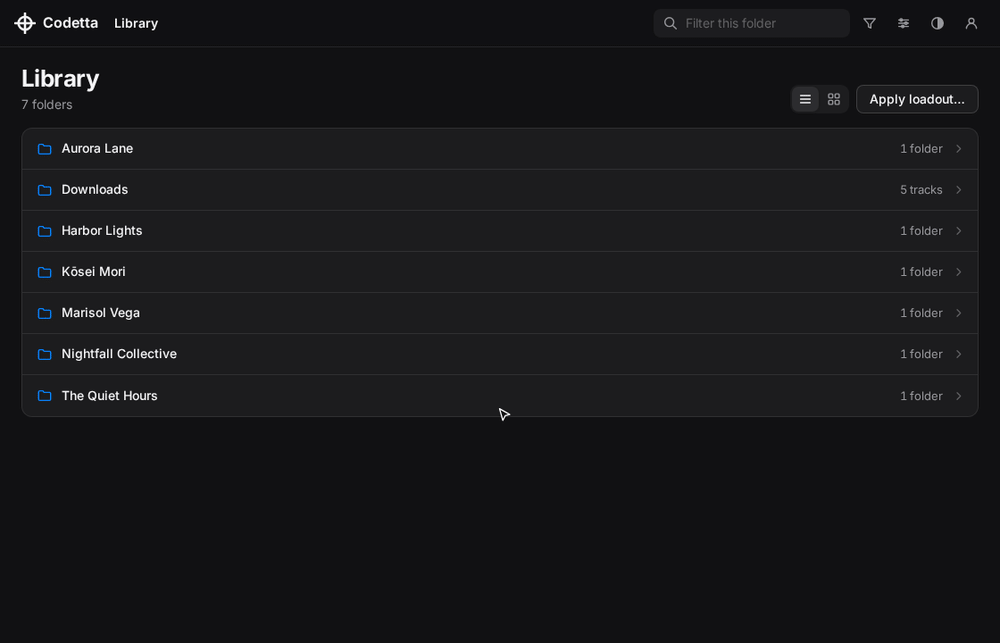
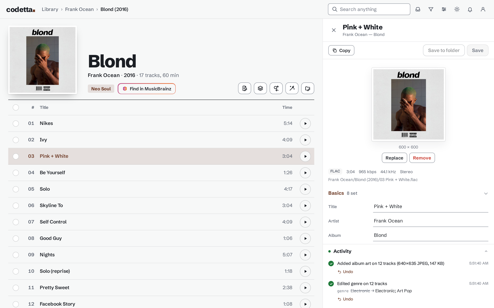

[← Back to the README](../README.md)

# Features

Everything Codetta does, in detail.

## Search your whole library

Type in the search box and press <kbd>Enter</kbd> to search every track you
own. Search by tag, and combine as much as you like:

| Type | Finds |
|---|---|
| `genre: rap, hip-hop` | tracks whose genre is Rap **or** Hip-Hop (but not "Trap") |
| `artist: drake` | everything by Drake, including features ("Drake & Future") |
| `genre: rap year: 2024` | both at once |
| `night drive` | those words in the title, artist, album or file name |

It ignores case and accents ("beyonce" finds "Beyoncé"). Results work like a
folder, so you can select them and edit them all at once. You can also start a
search from the filter button: pick a tag and a value, then **Search library**.

  

## Fix a whole album in one go

Fill in the album details once, drop in a cover, and **Save to folder** applies
exactly those changes to every track. You see the full list of changes before
anything is written.

  

## Turn loose downloads into proper releases

**Tag Loadouts** are saved sets of tags with placeholders like
`{filename_title}`, `{folder}` and `{track}/{tracktotal}`. Apply one to a file,
a selection or a folder, and loose downloads become properly tagged singles or
albums. You always get a preview first, and you choose whether to only fill
empty tags or overwrite them.

  

## Undo anything

Every change lands in the activity log with its old and new values. Changed
your mind? Undo it right from the log, even across a whole album, and redo it
if you change it back. Files that were edited again since are left alone,
never overwritten.

  

## Made for your phone too

Codetta is designed for iPhone and Android as much as for desktop: big touch
targets, a full-screen editor sheet, **Select** mode like the Photos app, and
covers straight from your photo library (HEIC included).

  
  &nbsp;
  
  &nbsp;
  

## And the rest

- **Edit one track or many.** Select several tracks and change only the fields
  you need. Fields that differ show as *Multiple values* and are left alone
  unless you touch them.
- **Smart suggestions.** Album-level fields suggest values the other tracks in
  the folder already use, and Track suggests the file's position (`2/6`).
- **Copy & paste tags** between tracks and folders.
- **Album art everywhere.** A thumbnail on every track, and covers you can
  add, replace or remove as part of a normal save.
- **Filter a folder by tag**, e.g. *Label: Independent*.
- **Fast on big libraries.** Folders load one at a time, and search uses a
  small index that Codetta keeps up to date in the background, so even tens
  of thousands of tracks stay quick.
- **Any language, any script.** Japanese, Hindi, Korean, Thai, Arabic, accented
  names and emoji are saved exactly as typed. Search ignores accents
  ("beyonce" finds "Beyoncé") and right-to-left names display correctly.
- **Light and dark themes** that follow your device, with smooth, subtle
  animations (off when your system asks for reduced motion).
- **Works offline.** No CDNs, no tracking, fonts bundled. The only thing Codetta
  ever sends out is an optional check for new versions.

  <picture>
    <source media="(prefers-color-scheme: dark)" srcset="screenshots/editor-dark.png">
    
  </picture>

## How Codetta keeps your files safe

Your library matters, so Codetta is careful with it:

- **The original is never touched until the change is verified.** Each save
  goes to a temporary copy, which is read back to check that every tag landed
  correctly, then swapped in with a single atomic step. If anything goes wrong
  (a full disk, a crash, a power cut), the original file is left exactly as it
  was.
- **Nothing else changes.** Tags you didn't edit, embedded art, permissions
  and ownership are preserved. Symlinks are followed, not replaced, and
  hard-linked copies (say, a torrent that's still seeding) keep their
  original bytes.
- **Codetta only writes when you ask.** Browsing never modifies a file. Bulk
  actions ask you to confirm first, and everything can be undone.
- **It doesn't rename, move or delete files.** Only tags and embedded art
  change.
- **It's tested.** Over 500 automated tests cover every format, including
  corrupt, truncated and mislabelled files, every script and emoji, read-only
  folders, interrupted writes, simultaneous saves and attack attempts.

## Supported formats

| Format | Extensions | Notes |
|---|---|---|
| FLAC | `.flac` | Any tag name is allowed. |
| MP3 | `.mp3` | All of Codetta's fields. Saved as ID3v2.4, which Navidrome and modern players read; some older software prefers ID3v2.3. |
| AAC / ALAC | `.m4a` | All of Codetta's fields. |
| Ogg Vorbis | `.ogg` | Any tag name is allowed. |
| Opus | `.opus` | Any tag name is allowed. |

Codetta detects the real format from each file's contents, so a mislabelled
file still opens correctly.
